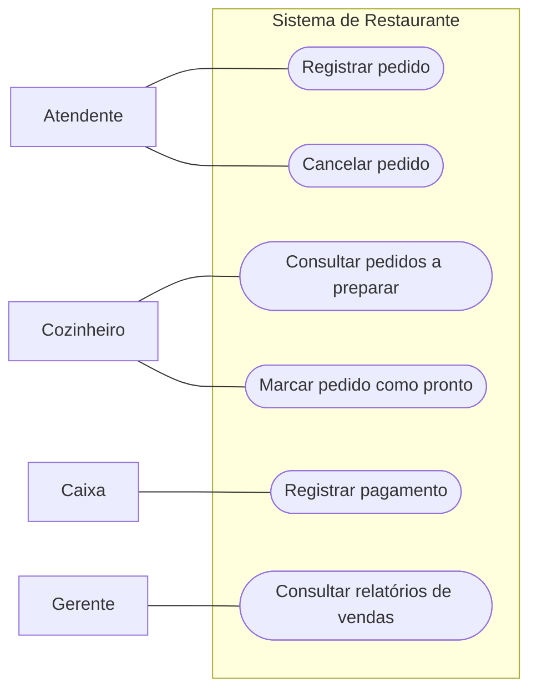
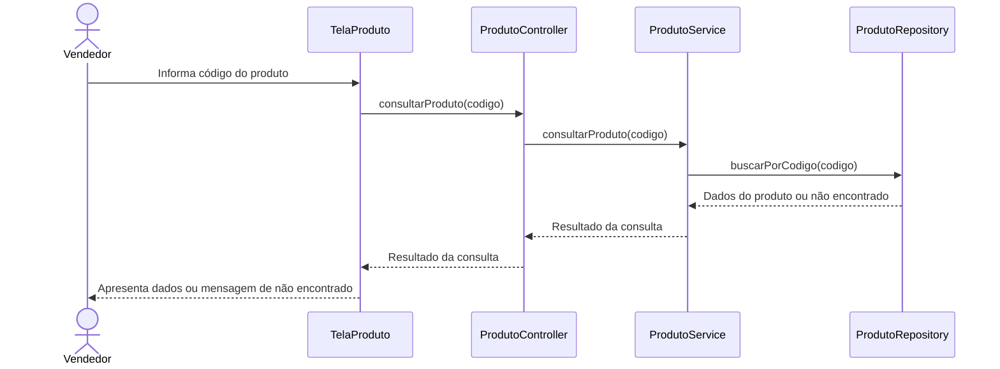
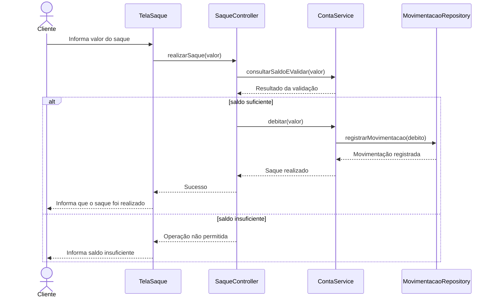
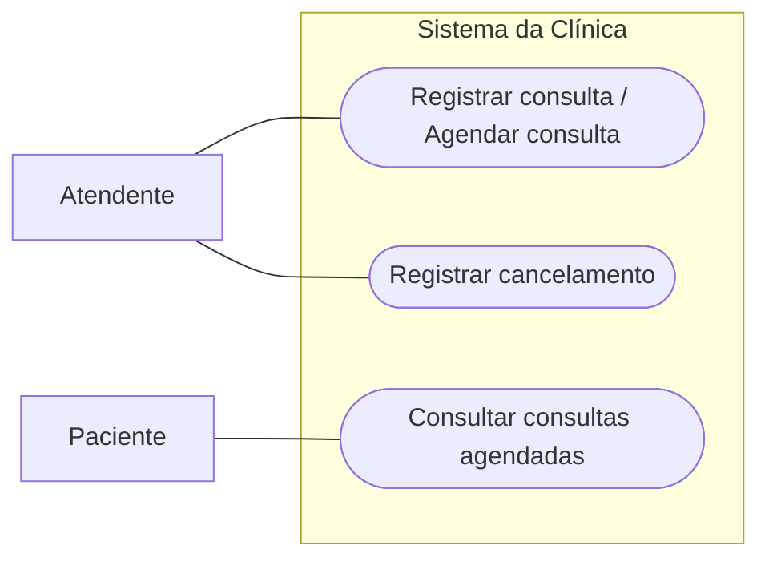
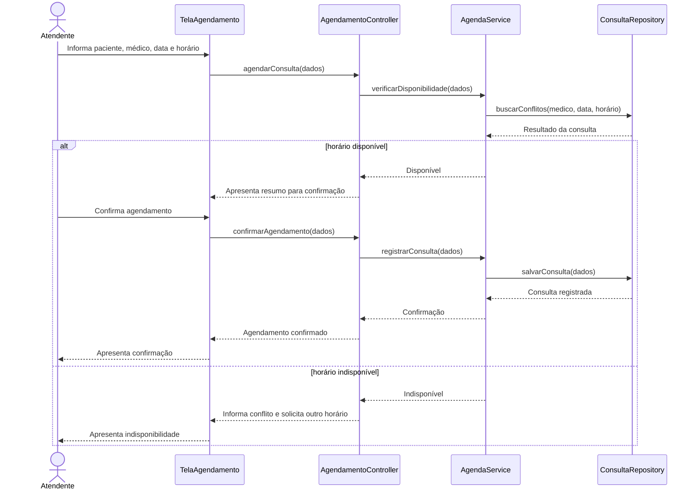

# Lista 05 — Análise e Projeto de Software
## Respostas

> As respostas dos exercícios 1 a 3 seguem a mesma linha dos estudos anteriores: respostas objetivas, com justificativas e nomenclatura de RN, RF e RNF. Os diagramas foram representados em Mermaid para facilitar a leitura e a edição.

---

# Exercício 1 — Processo de desenvolvimento de software

### a) Quais problemas podem surgir?

- Requisitos podem ser entendidos de maneiras diferentes por cada desenvolvedor.
- Funcionalidades podem ficar inconsistentes ou não atender às necessidades do cliente.
- A falta de documentação dificulta a manutenção e a entrada de novos integrantes.
- A ausência de testes aumenta o risco de defeitos chegarem aos usuários.
- Conhecimento importante fica concentrado em pessoas específicas.
- Mudanças podem gerar retrabalho, atrasos e aumento de custos.

### b) O que é um processo de desenvolvimento de software?

É um conjunto organizado de atividades, responsabilidades e procedimentos utilizados para especificar, projetar, implementar, validar e evoluir um software de maneira sistemática.

### c) Quatro atividades do processo

1. **Especificação:** levantar, analisar, documentar e validar os requisitos.
2. **Projeto e implementação:** definir a estrutura da solução e transformar o projeto em código.
3. **Validação:** realizar revisões e testes para verificar se o software atende às especificações e às necessidades dos usuários.
4. **Evolução:** corrigir defeitos, adaptar funcionalidades e incorporar novas necessidades.

### d) Como essas atividades reduzem os problemas?

A especificação registra e esclarece o que deve ser desenvolvido. O projeto orienta a organização da solução. A implementação seguindo esse projeto reduz decisões inconsistentes. A validação encontra defeitos antes da entrega. A evolução, apoiada pela documentação e pelos testes, permite realizar mudanças com menos risco e retrabalho.

---

# Exercício 2 — Regras de Negócio e Requisitos

### a) Clientes com habilitação vencida não podem alugar veículos.

**RN — Regra de Negócio.** Define uma restrição da locação que existe independentemente de o processo ser realizado por software ou manualmente.

### b) O sistema deve permitir que o atendente registre uma locação.

**RF — Requisito Funcional.** Descreve uma função que o sistema deve oferecer.

### c) Uma locação deve possuir período mínimo de uma diária.

**RN — Regra de Negócio.** Estabelece uma condição comercial para a locação.

### d) O sistema deve apresentar os veículos disponíveis em até 3 segundos.

**RNF — Requisito Não Funcional, categoria desempenho.** Define um limite mensurável para o tempo de resposta.

### e) O sistema deve permitir registrar a devolução de um veículo.

**RF — Requisito Funcional.** Especifica uma operação que o sistema precisa disponibilizar.

### f) Clientes menores de 21 anos não podem alugar veículos da categoria premium.

**RN — Regra de Negócio.** Define uma restrição de elegibilidade para determinada categoria de veículo.

### g) O sistema deve exigir autenticação dos funcionários.

**RNF — Requisito Não Funcional, categoria segurança.** Determina uma condição de controle de acesso ao sistema.

### Diferença entre Regra de Negócio e Requisito de Software

Uma **Regra de Negócio** estabelece políticas, condições ou restrições do domínio e existe independentemente do software. Um **Requisito de Software** especifica uma função, qualidade ou restrição que a solução precisa atender para apoiar o negócio e respeitar suas regras.

---

# Exercício 3 — Sistema de academia

### a) Regras de Negócio

- **RN01:** Cada aula possui um limite máximo de participantes.
- **RN02:** Um aluno não pode possuir duas reservas para aulas que ocorram no mesmo horário.
- **RN03:** Alunos com mensalidade vencida não podem realizar novos agendamentos.

### b) Requisitos Funcionais

- **RF01:** O sistema deve permitir que o aluno consulte as aulas disponíveis.
- **RF02:** O sistema deve permitir que o aluno realize uma reserva em uma aula.
- **RF03:** O sistema deve permitir que o aluno cancele uma reserva.
- **RF04:** Ao solicitar uma reserva, o sistema deve verificar as regras aplicáveis, incluindo o limite de participantes, conflitos de horário e situação da mensalidade.

### c) Requisito Não Funcional

- **RNF01 — Desempenho:** A consulta das aulas disponíveis deve apresentar o resultado em até dois segundos.

É um RNF porque estabelece uma condição de desempenho mensurável, em vez de descrever uma funcionalidade.

### d) Como uma Regra de Negócio influencia Requisitos Funcionais?

A regra define uma condição que o sistema precisa respeitar ao executar uma função. Por exemplo, a RN03 influencia o RF02: ao tentar reservar uma aula, o sistema deve verificar a situação da mensalidade e impedir o agendamento se ela estiver vencida. Uma regra também pode influenciar vários requisitos funcionais.

---

# Exercício 4 — Sistema de biblioteca

### a) Possíveis atores

- **Aluno:** consulta livros disponíveis e seu histórico de empréstimos.
- **Bibliotecário:** registra empréstimos e devoluções.
- **Coordenador da biblioteca:** cadastra livros e bloqueia usuários.
- **Serviço externo de autenticação:** valida o acesso dos usuários.

### b) Principais Casos de Uso

- Consultar livros disponíveis.
- Consultar histórico de empréstimos.
- Registrar empréstimo.
- Registrar devolução.
- Cadastrar livro.
- Bloquear usuário.
- Autenticar usuário.

### c) Relação entre atores e Casos de Uso

| Ator | Casos de Uso |
|---|---|
| Aluno | Consultar livros disponíveis; Consultar histórico de empréstimos |
| Bibliotecário | Registrar empréstimo; Registrar devolução |
| Coordenador da biblioteca | Cadastrar livro; Bloquear usuário |
| Serviço externo de autenticação | Validar/autenticar acesso quando o sistema solicita a verificação |

A autenticação pode ser uma etapa comum que antecede os casos de uso protegidos, conforme as regras de acesso definidas para o sistema.

### d) O serviço externo pode ser um ator?

Sim. Um ator representa um papel externo que interage com o sistema, e não precisa ser uma pessoa. Como o serviço de autenticação é externo e troca informações com o sistema da biblioteca, pode ser representado como ator secundário.

### e) Por que ações de interface normalmente não são Casos de Uso?

“Clicar no botão Emprestar”, “abrir a tela de livros” e “digitar matrícula” são ações de interface ou passos internos. Um Caso de Uso representa um objetivo que um ator deseja alcançar, como **Registrar Empréstimo** ou **Consultar Livros Disponíveis**, e não cada interação isolada com a tela.

---

# Exercício 5 — Revisão de um Caso de Uso

### a) Pelo menos cinco problemas

1. “Fazer Reserva” não informa claramente o objetivo ou o objeto da reserva.
2. “Cliente abre a tela” descreve uma ação de interface, não o objetivo do ator.
3. “Cliente escolhe” não diz o que é escolhido.
4. “Sistema verifica” não especifica o que é verificado nem quais regras são aplicadas.
5. “Cliente confirma” não esclarece o que está sendo confirmado.
6. “Sistema salva” não identifica quais dados são registrados.
7. “Sistema finaliza” não informa o resultado entregue ao cliente.
8. Não há pré-condições, pós-condições, fluxos alternativos ou exceções.

### b) Por que essas expressões prejudicam a compreensão?

São genéricas e ambíguas. Não permitem saber qual informação foi verificada, o que foi persistido ou qual resultado deve ocorrer. Isso dificulta a validação do Caso de Uso, a implementação e a criação de testes.

### c) Elementos ausentes

Faltam objetivo, pré-condições, pós-condições, dados necessários, regras de negócio relacionadas, requisitos relacionados, fluxo alternativo e fluxo de exceção.

### d) Fluxo principal reescrito

**UC01 — Fazer Reserva**

**Ator principal:** Cliente.

**Objetivo:** Permitir que o cliente registre uma reserva para uma opção disponível.

**Pré-condições:** O cliente está identificado e as opções de reserva podem ser consultadas.

**Fluxo principal:**
1. O cliente solicita uma nova reserva.
2. O sistema apresenta as opções disponíveis.
3. O cliente seleciona a opção desejada e informa os dados necessários, como data e horário.
4. O sistema verifica a disponibilidade e valida os dados informados.
5. O sistema apresenta o resumo da reserva e as condições aplicáveis.
6. O cliente confirma a reserva.
7. O sistema registra a reserva.
8. O sistema apresenta a confirmação e os dados da reserva.

**Fluxo alternativo — opção indisponível:** No passo 4, se a opção não estiver disponível, o sistema informa a indisponibilidade e permite que o cliente selecione outra opção.

**Fluxo de exceção — falha no registro:** No passo 7, se ocorrer uma falha ao registrar a reserva, o sistema informa que não foi possível concluir a operação e não apresenta a reserva como confirmada.

**Pós-condição de sucesso:** A reserva está registrada e sua confirmação foi apresentada ao cliente.

---

# Exercício 6 — Caso de Uso: Registrar Reserva de Hotel

## UC01 — Registrar Reserva

- **Objetivo:** Permitir que o atendente registre uma reserva de quarto para um cliente.
- **Ator principal:** Atendente.
- **Requisito relacionado:** RF01 — O sistema deve permitir que o atendente registre reservas.
- **Regras relacionadas:** RN01, RN02, RN03 e RN04.

### Pré-condições

- O atendente está autenticado.
- O cliente está identificado ou pode ser cadastrado durante o processo.
- As datas de entrada e saída foram informadas.

### Pós-condições

- **Sucesso:** A reserva está registrada com cliente, quarto e período definidos.
- **Falha:** Nenhuma reserva é confirmada sem que as validações necessárias sejam concluídas.

### Fluxo principal

1. O atendente inicia o registro de uma reserva.
2. O sistema solicita os dados do cliente, as datas de entrada e saída e as características do quarto desejado.
3. O atendente informa os dados.
4. O sistema verifica se a data de saída é posterior à data de entrada (**RN02**).
5. O sistema verifica se o cliente já possui reserva para o mesmo período (**RN03**).
6. O sistema consulta os quartos e verifica a disponibilidade para todo o período (**RN01**).
7. O sistema apresenta as opções disponíveis e as condições da reserva.
8. O atendente seleciona um quarto e confirma o registro.
9. O sistema registra a reserva e apresenta a confirmação.

### Fluxo alternativo A1 — Quarto indisponível

1. No passo 6, se não houver quarto disponível, o sistema informa a indisponibilidade.
2. O atendente pode pesquisar outro quarto ou período.
3. O fluxo retorna à seleção de opções.

### Fluxo alternativo A2 — Cliente já possui reserva no período

1. No passo 5, se o cliente já possuir uma reserva conflitante, o sistema informa o conflito.
2. O atendente informa outro período ou encerra a operação.

### Fluxo de exceção E1 — Datas inválidas

1. No passo 4, se a saída não for posterior à entrada, o sistema informa que as datas são inválidas.
2. O atendente corrige as datas antes de continuar.

### Fluxo de exceção E2 — Falha ao salvar

1. Se o sistema falhar ao registrar a reserva, informa que a operação não foi concluída.
2. O sistema não apresenta a reserva como confirmada e permite uma nova tentativa.

### Regra de cancelamento — RN04

A reserva pode ser cancelada sem cobrança até 24 horas antes do check-in. Essa regra deve ser considerada no Caso de Uso específico **Cancelar Reserva**, que precisa verificar o horário do check-in e o momento da solicitação. Ela não deve ser tratada como se fosse uma etapa obrigatória do registro da reserva.

### Como verificar a coerência com as Regras de Negócio?

Conferindo se cada regra aplicável aparece em uma validação ou decisão do fluxo, se os caminhos alternativos e de exceção estão definidos e se nenhum fluxo permite confirmar uma reserva que viole as regras. Também é importante relacionar as regras aos requisitos e aos testes correspondentes.

---

# Exercício 7 — Sistema de restaurante

### a) Atores

- Atendente.
- Cozinheiro.
- Caixa.
- Gerente.

### b) Casos de Uso

- Registrar pedido.
- Cancelar pedido.
- Consultar pedidos a preparar.
- Marcar pedido como pronto.
- Registrar pagamento.
- Consultar relatórios de vendas.

### c) Diagrama de Casos de Uso

### d) O que representa a fronteira do sistema?

É o limite que separa as funcionalidades pertencentes ao sistema dos atores externos que interagem com ele. Os Casos de Uso ficam dentro da fronteira; os atores ficam fora.

### e) Diferença entre ator e Caso de Uso

- **Ator:** papel externo que interage com o sistema para alcançar um objetivo.
- **Caso de Uso:** funcionalidade ou conjunto de interações que permite ao ator alcançar esse objetivo.

### f) O diagrama mostra a ordem das operações?

Não. O Diagrama de Casos de Uso mostra atores, funcionalidades e suas associações, mas não descreve a sequência temporal das operações. Para representar a ordem das mensagens em um cenário, utiliza-se, por exemplo, o Diagrama de Sequência.

---

# Exercício 8 — Diagrama de Sequência: Consultar Produto

### a) Diagrama de Sequência

### b) Quem recebe inicialmente a interação do ator?

A **TelaProduto**, que representa a interface (*boundary*) com a qual o vendedor interage.

### c) Quem coordena a operação?

O **ProdutoController**, que recebe a solicitação da interface e coordena a execução do caso de uso, delegando a consulta ao serviço apropriado.

### d) Quem consulta os dados?

O **ProdutoRepository** é responsável por acessar a persistência dos dados. O **ProdutoService** aplica a lógica da operação e solicita a consulta ao repositório.

### e) Por que a ordem vertical importa?

O tempo é representado de cima para baixo. A posição das mensagens indica a ordem em que as interações ocorrem, ajudando a compreender dependências e a sequência do cenário.

---

# Exercício 9 — Diagrama de Sequência: Realizar Saque

### Diagrama de Sequência

### Finalidade do fragmento `alt`

O fragmento `alt` representa caminhos alternativos condicionais. Apenas o caminho cuja condição for verdadeira é executado. Neste caso, se houver saldo suficiente, o sistema realiza o débito e registra a movimentação; se não houver, informa que o saque não pode ser realizado e não registra um débito concluído.

---

# Exercício 10 — Sistema de clínica

## Parte A — Regras e Requisitos

### a) Regras de Negócio

- **RN01:** Um médico não pode possuir duas consultas no mesmo horário.
- **RN02:** Somente horários disponíveis podem ser agendados.

### b) Requisitos Funcionais

- **RF01:** O sistema deve permitir que o atendente registre consultas.
- **RF02:** O sistema deve permitir que o atendente registre cancelamentos.
- **RF03:** O sistema deve permitir que o paciente consulte suas consultas agendadas.
- **RF04:** Ao registrar uma consulta, o sistema deve verificar a disponibilidade do médico no horário solicitado e impedir conflitos.

### c) Requisito Não Funcional

- **RNF01 — Desempenho:** A consulta dos horários disponíveis deve ser realizada em até dois segundos.

É um requisito de desempenho porque define um limite para o tempo de resposta do sistema.

## Parte B — Caso de Uso: Agendar Consulta

- **Ator principal:** Atendente.
- **Objetivo:** Registrar uma consulta para um paciente com um médico, em data e horário disponíveis.
- **Pré-condições:** O atendente está autenticado e o paciente e o médico podem ser identificados.
- **Pós-condição de sucesso:** A consulta está registrada e associada ao paciente, médico, data e horário escolhidos.

### Fluxo principal

1. O atendente inicia o agendamento.
2. O sistema solicita a identificação do paciente, o médico, a data e o horário.
3. O atendente informa os dados.
4. O sistema valida os dados e consulta a agenda do médico.
5. O sistema verifica se o horário está disponível e se não existe outra consulta do mesmo médico nesse horário.
6. O sistema apresenta o resumo do agendamento.
7. O atendente confirma.
8. O sistema registra a consulta.
9. O sistema apresenta a confirmação.

### Fluxo alternativo A1 — Horário indisponível

1. No passo 5, se o horário estiver ocupado, o sistema informa a indisponibilidade.
2. O atendente seleciona outro horário.
3. O fluxo retorna à consulta da agenda.

### Fluxo de exceção E1 — Falha ao registrar

1. Se ocorrer uma falha ao salvar a consulta, o sistema informa que o agendamento não foi concluído.
2. A consulta não deve ser apresentada como confirmada e o atendente pode tentar novamente.

## Parte C — Diagrama de Casos de Uso

O enunciado informa que o atendente registra consultas e cancelamentos, enquanto o paciente consulta suas consultas agendadas. Não foi atribuída ao paciente a função de realizar o agendamento diretamente.

## Parte D — Diagrama de Sequência: Agendar Consulta

## Parte E — Integração dos conceitos

| Artefato | Pergunta que responde | Finalidade |
|---|---|---|
| **Regra de Negócio (RN)** | Quais condições e restrições governam o negócio? | Define políticas e restrições que devem ser respeitadas, independentemente do software. |
| **Requisito (RF/RNF)** | O que o sistema deve fazer e quais qualidades deve atender? | Especifica funcionalidades, comportamentos e atributos de qualidade necessários. |
| **Caso de Uso** | Como o ator alcança seu objetivo utilizando o sistema? | Descreve o objetivo, as pré/pós-condições e os fluxos principal, alternativos e de exceção. |
| **Diagrama de Casos de Uso** | Quem interage com o sistema e quais objetivos pode alcançar? | Apresenta uma visão geral dos atores, funcionalidades e suas associações. |
| **Diagrama de Sequência** | Como os participantes colaboram, em que ordem e por meio de quais mensagens? | Detalha a interação temporal dos participantes para realizar um cenário. |

Os artefatos se complementam: as regras orientam os requisitos; os requisitos são detalhados em Casos de Uso; o Diagrama de Casos de Uso apresenta uma visão geral das funcionalidades e atores; e o Diagrama de Sequência detalha a colaboração necessária para executar um cenário.
