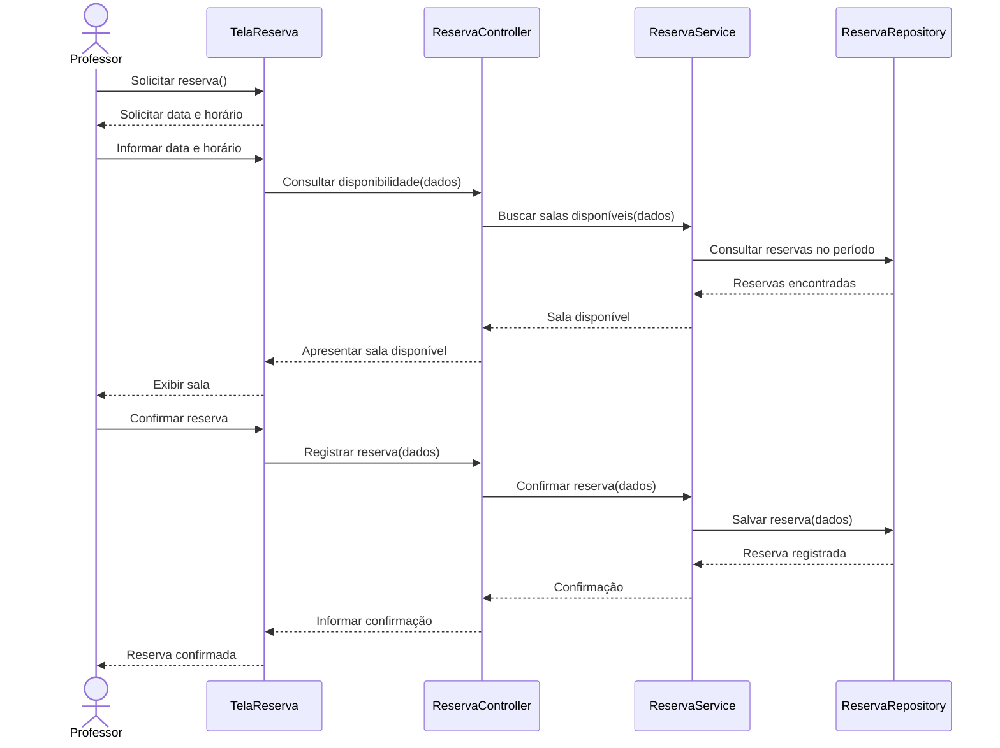
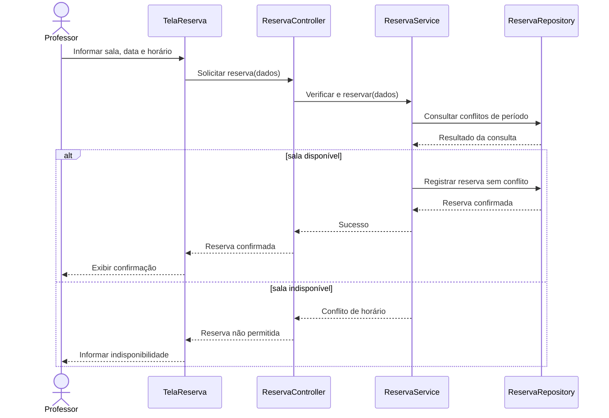
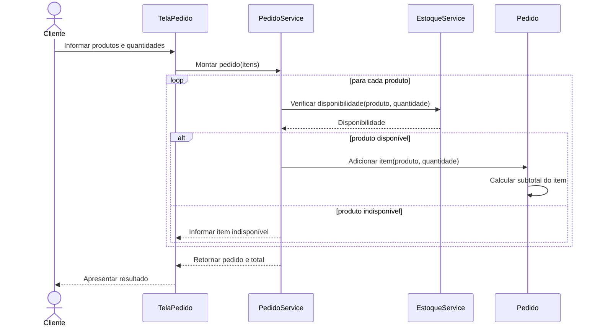
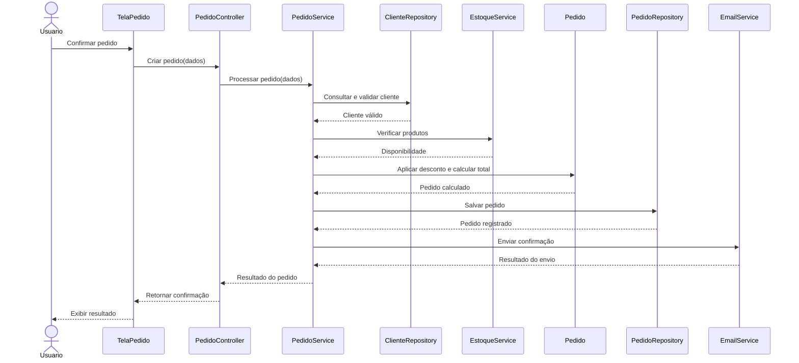
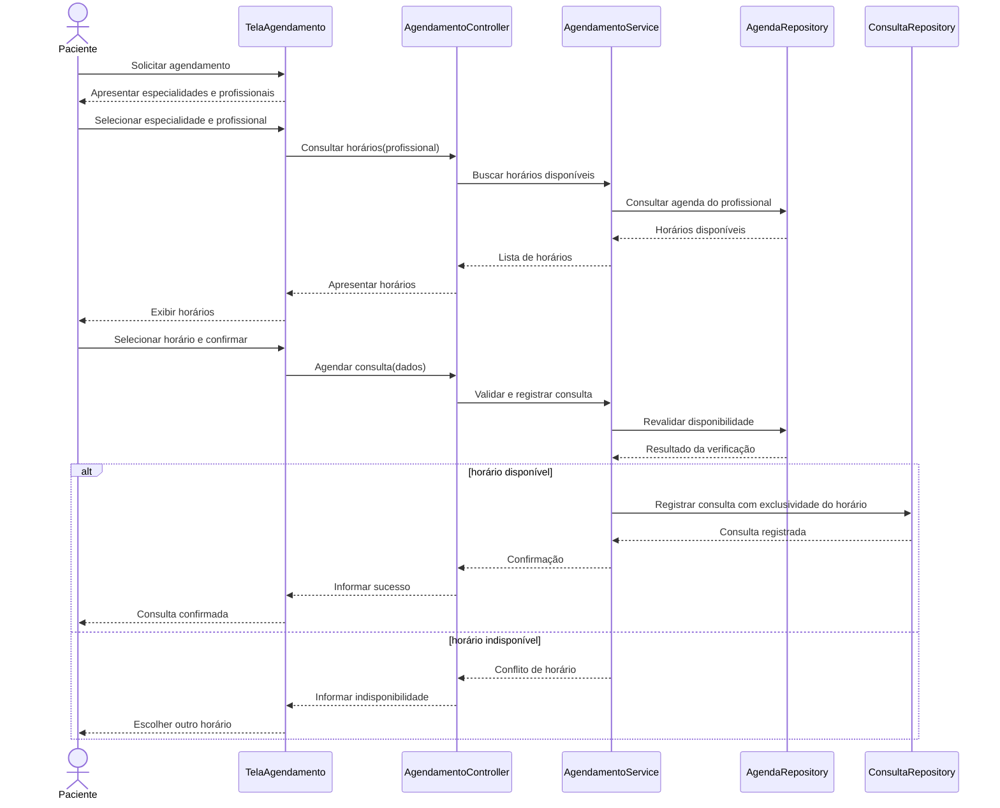
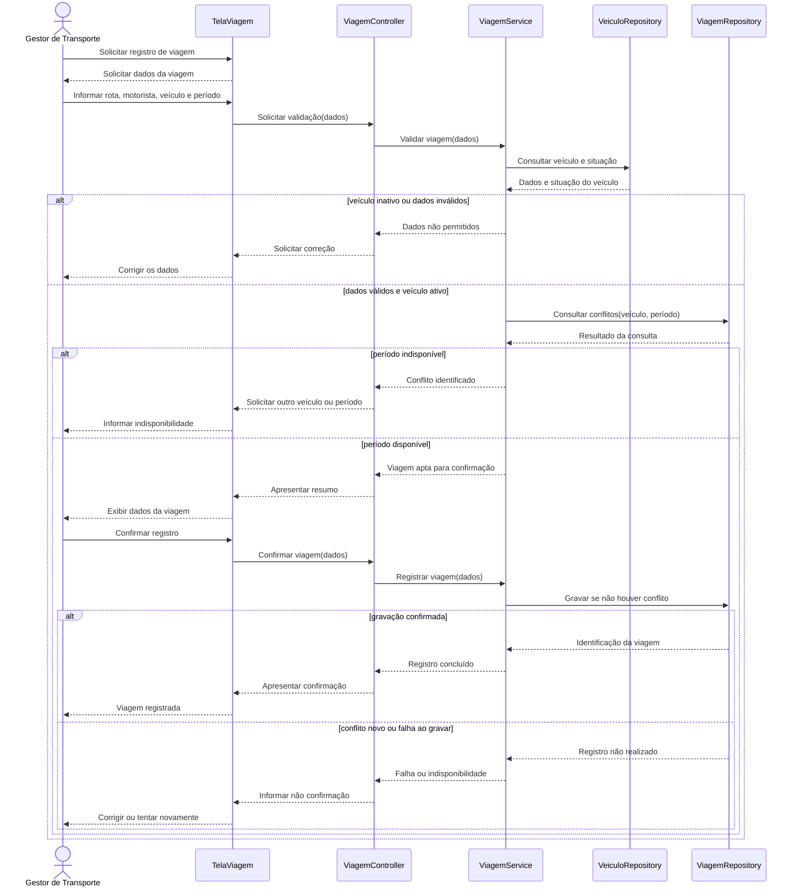

# Lista de Exercícios Resolvida — Análise e Projeto de Software

**Atividades 03 e 04 — Exercícios 1 a 24**  
**Projeto utilizado nas questões da equipe:** [VanTrack](https://github.com/luisgustavoribeirodefreitas/VanTrack)

> **Observação sobre o VanTrack:** na consulta ao repositório público, foi possível identificar o projeto e seu `README.md`, mas não havia uma descrição detalhada de regras, requisitos ou casos de uso. Por isso, nos exercícios 12, 13, 15 e 24, foi desenvolvida **uma proposta de modelagem**, considerando o VanTrack como um sistema de gestão de viagens de vans. Os papéis, as regras e os fluxos desses exercícios são **sugestões para validação com a equipe**, e não funcionalidades confirmadas no repositório.

---

# Parte 1 — Discussão e compreensão dos conceitos

## Exercício 1 — Regra de Negócio × Requisito

**Regra de Negócio:** diz respeito às normas, condições e restrições que determinam como um negócio deve funcionar, independentemente da existência de um software.

**Requisito de Software:** diz respeito ao que o sistema precisa fazer ou às condições de qualidade que ele deve atender.

**Classificação:**

- **a) Regra de Negócio (RN).** Determina que um empréstimo não pode ultrapassar 30 dias.
- **b) Requisito Funcional (RF).** Define uma funcionalidade que o sistema deve oferecer: registrar empréstimos.
- **c) Requisito Não Funcional (RNF) — Segurança.** Exige autenticação em dois fatores para administradores. Também pode ter origem em uma política de negócio.
- **d) Regra de Negócio (RN).** Restringe novas compras para clientes com pagamentos vencidos.
- **e) Requisito Não Funcional (RNF) — Desempenho.** Estabelece o tempo máximo de resposta do sistema.

## Exercício 2 — Requisitos Funcionais e Não Funcionais

- **a) Permitir empréstimo de livros:** RF, pois representa uma funcionalidade do sistema.
- **b) Permitir consulta ao catálogo:** RF, pois permite que o usuário consulte informações.
- **c) Suportar 500 usuários simultâneos:** RNF de capacidade e desempenho.
- **d) Exigir autenticação para operações administrativas:** RNF de segurança e controle de acesso.
- **e) Funcionar nos principais navegadores atuais:** RNF de compatibilidade e portabilidade.
- **f) Apresentar resultados em até 2 segundos:** RNF de desempenho.

**Por que os RNFs não são menos importantes?**

Porque eles determinam características importantes para o funcionamento do sistema, como segurança, desempenho e compatibilidade. Um sistema pode possuir todas as funcionalidades e, mesmo assim, não atender às necessidades dos usuários se apresentar problemas nessas características.

## Exercício 3 — Por que Casos de Uso?

Casos de Uso são extremamente necessários, pois permitem visualizar como os usuários interagem com o sistema, quais passos são executados e se existem ajustes a serem realizados.

O Requisito Funcional informa **o que o sistema deve fazer**. Já o Caso de Uso descreve **como o ator utiliza essa funcionalidade para alcançar um objetivo**, incluindo as condições, os fluxos alternativos e os possíveis erros. Isso ajuda a verificar se a funcionalidade atende às necessidades reais dos usuários.

## Exercício 4 — Caso de Uso não é tela

**Bons candidatos a Casos de Uso:**

- **Cadastrar Cliente:** representa um objetivo completo do usuário.
- **Registrar Pedido:** representa uma funcionalidade com início, interação e resultado.
- **Cancelar Pedido:** representa um objetivo que produz uma alteração no sistema.

**Ações de interface ou etapas de um Caso de Uso:**

- **Abrir Tela de Cliente:** apenas permite acessar uma interface.
- **Clicar em Salvar:** é uma ação realizada durante um processo.
- **Digitar CPF:** é o preenchimento de uma informação.
- **Selecionar Produto:** normalmente é uma etapa para registrar um pedido.

O Caso de Uso deve representar o objetivo do ator, e não cada botão ou campo da tela.

## Exercício 5 — Atores

**a)** Estudante, Professor, Coordenador, Funcionário e Serviço Externo de Autenticação podem ser atores, desde que interajam com o sistema.

**b)** Sim. Um sistema externo pode ser ator quando troca informações ou presta algum serviço ao sistema principal.

**c)** Sim. Atores representam papéis, não pessoas específicas. Uma pessoa pode ser professor e coordenador, por exemplo.

**d)** Normalmente não. O banco de dados costuma fazer parte da infraestrutura interna do sistema. Ele só seria tratado como ator caso fosse um sistema externo e independente, com o qual a solução se comunica.

---

# Parte 2 — Identificação de Regras, Requisitos e Casos de Uso

## Exercício 6 — Sistema de estacionamento

### Regras de Negócio

- **RN01:** O valor cobrado deve considerar o período de permanência do veículo.
- **RN02:** Clientes conveniados recebem 20% de desconto.
- **RN03:** A saída do veículo somente deve ser liberada após o registro do pagamento.

### Requisitos Funcionais

- **RF01:** O sistema deve registrar a placa e o horário de entrada.
- **RF02:** O sistema deve registrar o horário de saída.
- **RF03:** O sistema deve calcular o valor conforme a permanência.
- **RF04:** O sistema deve identificar clientes conveniados e aplicar o desconto.
- **RF05:** O sistema deve permitir registrar o pagamento.
- **RF06:** O sistema deve permitir registrar a liberação de saída.
- **RF07:** O sistema deve armazenar e permitir consultar o histórico das operações.

### Possíveis Requisitos Não Funcionais

- **RNF01 — Segurança:** Apenas usuários autorizados podem registrar pagamentos.
- **RNF02 — Desempenho:** O cálculo da cobrança deve ser apresentado em até 2 segundos, em condições normais.
- **RNF03 — Integridade:** Os registros de entrada, saída e pagamento devem ser preservados de forma consistente.

*Os RNFs são propostas complementares, pois o enunciado não define valores de desempenho ou critérios de segurança.*

### Atores

- **Atendente:** registra entrada, saída e pagamento.
- **Cliente:** participa do processo do estacionamento, mas só será ator direto do software caso utilize alguma interface dele.

### Possíveis Casos de Uso

- **UC01 — Registrar Entrada de Veículo.**
- **UC02 — Registrar Saída de Veículo.**
- **UC03 — Calcular Valor da Permanência.**
- **UC04 — Registrar Pagamento.**
- **UC05 — Consultar Histórico de Operações.**

## Exercício 7 — Sistema acadêmico

| Regra | Requisito Funcional derivado | Caso de Uso afetado |
|---|---|---|
| RN01 — Nota entre 0 e 100 | **RF01:** Validar se a nota informada está entre 0 e 100 antes de salvá-la. | UC01 — Registrar Nota; UC02 — Alterar Nota. |
| RN02 — Só o professor responsável altera notas | **RF02:** Verificar se o usuário é o professor responsável pela turma antes de permitir alterações. | UC02 — Alterar Nota. |
| RN03 — Não alterar após fechamento | **RF03:** Impedir alterações de notas depois do fechamento do período. | UC02 — Alterar Nota; UC03 — Fechar Período. |
| RN04 — Frequência inferior a 75% reprova | **RF04:** Calcular a frequência e identificar reprovação por frequência quando o percentual for inferior a 75%. | UC04 — Registrar Frequência; UC05 — Apurar Resultado Acadêmico. |

Esses requisitos permitem que o sistema aplique as regras informadas e impeça operações que não deveriam ser realizadas.

---

# Parte 3 — Analisando Casos de Uso

## Exercício 8 — Encontre os problemas

**Problemas encontrados:**

1. O nome **Cadastro** não informa o que será cadastrado.
2. O ator **Usuário** é genérico e não identifica seu papel.
3. Não existe objetivo definido.
4. Não foram informadas as pré-condições e pós-condições.
5. Os passos estão focados em botões e telas.
6. A expressão **Sistema verifica** não explica o que será validado.
7. Não existem fluxos alternativos ou de exceção.
8. O resultado final não informa se o cadastro foi realizado com sucesso.

### Caso de Uso corrigido — UC01: Cadastrar Cliente

**Ator principal:** Atendente.  
**Objetivo:** Cadastrar um cliente para utilização das funcionalidades do sistema.  
**Gatilho:** O atendente solicita um novo cadastro.  
**Pré-condição:** Atendente autenticado.  
**Pós-condição:** Cliente cadastrado e disponível para consulta.

**Fluxo principal:**

1. O atendente solicita o cadastro de um cliente.
2. O sistema solicita os dados necessários.
3. O atendente informa os dados do cliente.
4. O sistema verifica os campos obrigatórios e se o documento já está cadastrado.
5. O sistema registra o cliente.
6. O sistema informa que o cadastro foi realizado com sucesso.

**Fluxos alternativos:**

- **A1 — Dados incompletos (passo 4):** O sistema solicita a correção dos campos e retorna ao passo 3.

**Exceções:**

- **E1 — Documento duplicado (passo 4):** O sistema informa que o cliente já está cadastrado e não duplica o registro.
- **E2 — Falha de persistência (passo 5):** O sistema informa o erro e não confirma o cadastro.

**Regras consideradas para completar o exemplo:** Campos obrigatórios devem estar preenchidos e o documento do cliente não pode ser duplicado.

## Exercício 9 — Caso de Uso incompleto

O Caso de Uso original não respeita todas as regras, pois registra o empréstimo sem verificar pendências do aluno, limite de livros, disponibilidade do exemplar e prazo de devolução.

### Versão corrigida — UC05: Realizar Empréstimo

**Ator principal:** Bibliotecário.  
**Objetivo:** Registrar o empréstimo de um livro para um aluno.  
**Gatilho:** O aluno solicita o empréstimo.  
**Pré-condições:** Bibliotecário autorizado e aluno identificado.  
**Pós-condições:** Empréstimo registrado, exemplar indisponível para outros empréstimos e data de devolução definida.

**Fluxo principal:**

1. O bibliotecário identifica o aluno.
2. O sistema localiza o aluno e verifica se existem empréstimos vencidos (**RN01**).
3. O sistema verifica se o aluno possui menos de cinco livros emprestados (**RN02**).
4. O bibliotecário informa o exemplar solicitado.
5. O sistema verifica se o exemplar está disponível (**RN03**).
6. O sistema calcula a data de devolução para 14 dias após o empréstimo (**RN04**).
7. O bibliotecário confirma a operação.
8. O sistema registra o empréstimo e informa a data de devolução.

**Fluxos alternativos:**

- **A1 — Aluno não localizado (passo 2):** O bibliotecário corrige a identificação ou encerra a operação.
- **A2 — Outro exemplar (passo 5):** O bibliotecário informa outro exemplar e o sistema verifica novamente a disponibilidade.

**Exceções:**

- **E1 — Empréstimo vencido (passo 2):** O sistema bloqueia um novo empréstimo.
- **E2 — Limite de cinco livros atingido (passo 3):** O sistema impede o empréstimo.
- **E3 — Exemplar indisponível (passo 5):** O sistema impede o empréstimo daquele exemplar.
- **E4 — Falha ao registrar (passo 8):** O sistema informa o erro e não confirma a operação.

---

# Parte 4 — Fluxos Alternativos e Exceções

## Exercício 10 — O *happy path* não é suficiente

### Três fluxos alternativos

1. **A1 — Alterar produtos (passo 1):** O cliente modifica a quantidade ou adiciona outro produto. O sistema atualiza o pedido e continua o processo.
2. **A2 — Alterar endereço (passo 2):** O cliente informa outro endereço válido e o sistema utiliza os novos dados.
3. **A3 — Escolher PIX (passo 4):** O cliente escolhe PIX em vez de cartão e o sistema segue com a forma de pagamento selecionada.

### Três fluxos de exceção

1. **E1 — Dados de entrega inválidos (passo 2):** O sistema informa o erro e solicita a correção antes de continuar.
2. **E2 — Produto indisponível (passo 3 ou na verificação final):** O sistema informa a indisponibilidade e impede a conclusão com aquele item.
3. **E3 — Pagamento recusado (passo 5):** O sistema informa a recusa e não registra o pedido como pago.

## Exercício 11 — Fluxo alternativo ou exceção?

- **a) PIX em vez de cartão — Fluxo alternativo.** Representa outra forma válida de realizar o pagamento.
- **b) Cartão recusado — Exceção.** Impede a conclusão normal do pagamento e exige tratamento.
- **c) Adicionar outro produto — Fluxo alternativo.** É uma possibilidade normal durante a montagem do pedido.
- **d) Produto sem estoque — Exceção.** Impede a confirmação com o item solicitado.
- **e) Informar cupom de desconto — Fluxo alternativo.** É uma ação opcional prevista no processo.
- **f) Cupom vencido — Exceção.** O desconto não pode ser aplicado e o sistema precisa informar o motivo.

**Todas precisam estar no mesmo Caso de Uso?**

Não necessariamente. Devem ser documentadas no Caso de Uso quando fizerem parte do seu comportamento. Processos maiores, como a execução do pagamento, podem ser especificados em outro Caso de Uso relacionado, evitando repetição e mantendo a rastreabilidade.

---

# Parte 5 — Testando a qualidade de um Caso de Uso

## Exercício 12 — Revisão por checklist (VanTrack)

Para aplicar o exercício, considerei a seguinte **proposta de Caso de Uso**, ainda não confirmada pela equipe:

**UC-V01 — Registrar Viagem:** um gestor registra uma viagem informando rota, veículo, motorista e período.

### Checklist de revisão

| Item | Situação inicial | Correção necessária |
|---|---|---|
| Identificador | Atendido | Manter UC-V01. |
| Nome orientado a objetivo | Atendido | Manter Registrar Viagem. |
| Ator principal | Ausente | Definir Gestor de Transporte. |
| Atores secundários | Não identificado | Informar que não há ator secundário obrigatório neste cenário. |
| Objetivo | Incompleto | Explicar que a viagem deve ser registrada sem conflitos de agenda. |
| Gatilho | Ausente | Definir solicitação de nova viagem pelo gestor. |
| Pré-condições | Ausentes | Gestor autorizado, motorista e veículo cadastrados. |
| Pós-condições | Ausentes | Viagem persistida e identificada, sem conflito. |
| Fluxo principal | Incompleto | Detalhar solicitação, validações, confirmação e registro. |
| Fluxos alternativos | Ausentes | Tratar escolha de outro veículo ou período. |
| Exceções | Ausentes | Tratar conflito de horário e falha de gravação. |
| Regras relacionadas | Ausentes | Relacionar VT-RN01, VT-RN02 e VT-RN03. |
| Requisitos relacionados | Ausentes | Relacionar VT-RF01, VT-RF02 e VT-RF03. |
| Resultado esperado | Incompleto | Informar identificação e confirmação da viagem. |

### Problemas principais

| Problema | Por que é um problema? | Correção proposta |
|---|---|---|
| Falta de validação de disponibilidade | Pode permitir duas viagens conflitantes com o mesmo veículo. | Verificar conflitos antes de confirmar e novamente ao salvar. |
| Falta de pré-condições | Não deixa claro quem pode registrar uma viagem. | Definir gestor autorizado e cadastros necessários. |
| Falta de exceções | Não descreve o que acontece em caso de falha. | Impedir confirmação indevida e informar o erro. |

A versão completa e corrigida desse Caso de Uso está apresentada no **Exercício 24**.

## Exercício 13 — Teste das perguntas (VanTrack)

Aplicação das perguntas ao fluxo principal proposto para **Registrar Viagem**:

| Passo | Quem? | O quê? | Sobre o quê? | E se não der certo? | Qual regra? | O que acontece depois? |
|---|---|---|---|---|---|---|
| 1 | Gestor | Solicita registro | Nova viagem | Solicitação não iniciada | — | Sistema solicita dados. |
| 2 | Sistema | Solicita informações | Rota, período, veículo e motorista | Dados não apresentados | VT-RN01 | Gestor informa dados. |
| 3 | Gestor | Informa dados | Viagem | Dados incompletos | VT-RN01 | Sistema valida. |
| 4 | Sistema | Valida identificação e situação | Motorista e veículo | Dados inválidos ou veículo inativo | VT-RN01, VT-RN03 | Consulta disponibilidade. |
| 5 | Sistema | Verifica conflitos | Veículo e período | Horário ocupado | VT-RN02 | Apresenta resumo ou alternativa. |
| 6 | Sistema | Apresenta resumo | Viagem proposta | Resumo divergente | VT-RN01 | Gestor confirma ou corrige. |
| 7 | Gestor | Confirma | Dados da viagem | Desiste da operação | — | Sistema revalida. |
| 8 | Sistema | Revalida e registra | Viagem e agenda | Novo conflito ou falha de gravação | VT-RN02 | Informa resultado. |
| 9 | Sistema | Apresenta confirmação | Viagem registrada | Falha de comunicação | — | Caso de Uso termina. |

**Informações que as perguntas revelaram:** necessidade de verificar se o veículo está ativo, tratar horários conflitantes, distinguir confirmação da gravação efetiva e revalidar a disponibilidade antes do registro. Sem isso, o fluxo estaria incompleto.

---

# Parte 6 — Rastreabilidade

## Exercício 14 — Construa a cadeia

**RN07:** Descontos superiores a 15% devem ser autorizados pelo gerente.

**RF07:** O sistema deve solicitar autorização do gerente quando um desconto informado ultrapassar 15% e impedir sua aplicação até a autorização.

**UC07 — Aplicar Desconto ao Pedido:** o vendedor informa o desconto e o sistema verifica sua aplicação.

**Fluxo alternativo A1 — Desconto superior a 15%:**

1. O vendedor informa um desconto superior a 15%.
2. O sistema identifica que é necessária autorização.
3. O gerente analisa a solicitação.
4. Se o gerente autorizar, o sistema aplica o desconto.
5. Se o gerente negar, o sistema não aplica o desconto solicitado.

**Critério de aceitação:** Um desconto maior que 15% somente pode ser aplicado após autorização do gerente. Descontos de até 15% não exigem essa autorização por força da RN07.

**Cenário de teste:**

- **Dado** um pedido com um vendedor autorizado;
- **Quando** o vendedor solicita desconto de 20%;
- **Então** o sistema deve exigir autorização do gerente;
- **E** não deve aplicar o desconto antes dessa autorização;
- **Quando** o gerente aprova a solicitação;
- **Então** o sistema aplica o desconto de 20%.

**Teste negativo:** se o gerente negar, o pedido deve continuar sem o desconto de 20%.

## Exercício 15 — Matriz de rastreabilidade (VanTrack)

As regras e os requisitos abaixo foram **propostos para o exercício**, não extraídos de uma documentação oficial do VanTrack.

### Regras propostas

- **VT-RN01:** Toda viagem deve possuir um motorista, um veículo e um período identificados.
- **VT-RN02:** Um veículo não pode ser associado a viagens com períodos conflitantes.
- **VT-RN03:** Somente veículos ativos podem ser associados a novas viagens.
- **VT-RN04:** As viagens registradas devem permanecer disponíveis para consulta de histórico.

### Requisitos propostos

- **VT-RF01:** O sistema deve permitir cadastrar viagens e seus dados obrigatórios.
- **VT-RF02:** O sistema deve verificar conflitos de agenda do veículo antes de registrar uma viagem.
- **VT-RF03:** O sistema deve consultar a situação do veículo antes de associá-lo a uma viagem.
- **VT-RF04:** O sistema deve permitir consultar o histórico de viagens.

### Matriz

| Regra de Negócio | Requisito Funcional | Caso de Uso | Fluxo/Cenário |
|---|---|---|---|
| VT-RN01 | VT-RF01 | UC-V01 — Registrar Viagem | Validação dos dados obrigatórios. |
| VT-RN02 | VT-RF02 | UC-V01 — Registrar Viagem | Horário disponível / horário conflitante. |
| VT-RN03 | VT-RF03 | UC-V01 — Registrar Viagem | Veículo ativo / veículo inativo. |
| VT-RN04 | VT-RF04 | UC-V02 — Consultar Histórico de Viagens | Consulta de viagens registradas. |

**Existem regras sem requisitos?** Nesta proposta, não. Todas as regras listadas possuem um requisito correspondente.

**Existem requisitos sem Casos de Uso?** Nesta proposta, não. Todos os requisitos estão relacionados a um Caso de Uso.

**Existem comportamentos sem relação com requisito ou regra?** No detalhamento dos fluxos, podem surgir ações internas como consultar o banco de dados ou informar o resultado. Elas devem apoiar algum requisito ou Caso de Uso, mesmo que não precisem de uma Regra de Negócio própria.

**Isso necessariamente representa um erro?** Não. Uma decisão interna pode ser necessária para implementar um requisito. Porém, se ela modificar o comportamento do negócio, deve ser verificada com a equipe e documentada.

---

# Parte 7 — Introdução ao Diagrama de Sequência

## Exercício 16 — Caso de Uso × Diagrama de Sequência

**Caso de Uso:** descreve como o ator interage com o sistema para alcançar um objetivo. Apresenta o fluxo principal, alternativas, exceções e condições.

**Diagrama de Sequência:** representa como os participantes trocam mensagens ao longo do tempo para executar um cenário do Caso de Uso.

Um Diagrama de Sequência não substitui o Caso de Uso porque possui outro objetivo. O Caso de Uso especifica o comportamento esperado do ponto de vista do ator, enquanto o Diagrama de Sequência detalha a colaboração entre interfaces, controles, regras de domínio e persistência.

## Exercício 17 — Identificando participantes

| Tipo | Participante sugerido | Responsabilidade |
|---|---|---|
| Ator | Cliente | Solicitar a transferência e receber o resultado. |
| Interface / Boundary | TelaTransferencia | Receber dados e apresentar mensagens ao cliente. |
| Controle / Aplicação | TransferenciaController / TransferenciaService | Coordenar a solicitação e a execução do processo. |
| Domínio | Conta, Transferencia | Validar dados e regras, como saldo suficiente e valor permitido. |
| Persistência | ContaRepository / TransferenciaRepository | Consultar as contas e registrar a movimentação. |

A interface não deve ficar responsável pelas regras financeiras. Ela recebe a solicitação; a aplicação organiza as operações; o domínio aplica as regras; e a persistência acessa os dados.

---

# Parte 8 — Construção de Diagramas de Sequência

## Exercício 18 — Da especificação para a sequência

**UC03 — Reservar Sala (fluxo principal)**



O diagrama representa a ordem das mensagens, desde a solicitação do professor até o registro e a confirmação da reserva.

## Exercício 19 — Adicione uma decisão

**RN05:** Uma sala não pode possuir duas reservas em períodos conflitantes.



A RN05 aparece na consulta de conflitos e na decisão `alt`. Se a sala já estiver reservada no período, o sistema não pode registrar outra reserva. Na implementação, a verificação e a gravação precisam ser protegidas contra duas confirmações simultâneas.

## Exercício 20 — Adicione uma repetição



O `loop` é mais adequado porque a mesma sequência é executada para cada produto. Assim, o diagrama não precisa repetir manualmente as mensagens e continua válido para pedidos com diferentes quantidades de itens.

---

# Parte 9 — Encontrando problemas no projeto

## Exercício 21 — Quem deveria fazer isso?

**1. Qual é o problema?**

O problema é a concentração de muitas responsabilidades na `TelaPedido`. Ela está realizando atividades que deveriam pertencer às camadas de aplicação, domínio ou infraestrutura.

**2. Quais responsabilidades estão concentradas indevidamente?**

Validação de cliente, verificação de estoque, cálculo de desconto, cálculo do total, gravação do pedido e envio de e-mail.

**3. Como distribuir?**

- **Interface:** receber dados e apresentar resultados.
- **Controller/Aplicação:** coordenar o processo de criação do pedido.
- **Domínio:** validar as regras relacionadas ao pedido e calcular descontos e valores.
- **Infraestrutura:** consultar e gravar dados e realizar o envio de e-mail.

### Solução proposta



Dessa forma, cada participante possui uma responsabilidade definida. Uma falha no envio do e-mail deve ser tratada sem afirmar que o pedido não foi salvo, quando a gravação já tiver sido concluída.

## Exercício 22 — Mensagens sem origem

A mensagem `bloquearCliente()` não pode ser considerada correta apenas porque aparece no Diagrama de Sequência. É necessário verificar sua origem.

1. **Diagrama errado:** se não existe nenhuma necessidade de bloqueio, a mensagem foi adicionada indevidamente e deve ser removida.
2. **Requisito incompleto:** se o usuário realmente precisa do bloqueio, o requisito deve ser complementado.
3. **Regra de Negócio não documentada:** se há uma política que determina o bloqueio, ela precisa ser identificada e registrada.
4. **Decisão interna de projeto:** pode ser legítima se o bloqueio for apenas um controle técnico necessário, sem criar uma regra de negócio nova. Nesse caso, é preciso justificar sua finalidade.

**Como decidir?**

Deve-se consultar o domínio, os requisitos, os responsáveis pelo negócio e os outros Casos de Uso. Se a ação modificar os direitos ou o comportamento esperado do cliente, não pode ser introduzida somente como decisão técnica.

---

# Parte 10 — Exercício Integrador

## Exercício 23 — Do problema ao Diagrama de Sequência

### 1. Regras de Negócio

- **RN01:** Um profissional não pode possuir duas consultas no mesmo horário.
- **RN02:** Uma consulta somente pode ser agendada em horário disponível.
- **RN03:** O paciente somente pode cancelar uma consulta até 24 horas antes do horário agendado.
- **RN04:** Todas as consultas e cancelamentos devem ser registrados.

### 2. Requisitos Funcionais

- **RF01:** O sistema deve permitir consultar especialidades, profissionais, datas e horários disponíveis.
- **RF02:** O sistema deve permitir agendar consultas.
- **RF03:** O sistema deve verificar conflitos de horário antes de confirmar o agendamento.
- **RF04:** O sistema deve permitir cancelar consultas conforme o limite de 24 horas.
- **RF05:** O sistema deve registrar consultas e cancelamentos.
- **RF06:** O sistema deve permitir consultar os agendamentos realizados.

### 3. Possíveis Requisitos Não Funcionais

- **RNF01 — Segurança:** Apenas usuários autorizados devem acessar informações de consultas.
- **RNF02 — Desempenho:** A consulta de horários disponíveis deve retornar em até 2 segundos em condições normais.
- **RNF03 — Integridade:** O sistema deve impedir gravações simultâneas que produzam consultas conflitantes.
- **RNF04 — Auditoria:** Registros de agendamento e cancelamento devem preservar as informações necessárias à rastreabilidade.

*Esses RNFs são propostas complementares, não condições expressas no enunciado.*

### 4. Atores

- **Paciente:** solicita o agendamento ou cancelamento.
- **Profissional de saúde:** possui uma agenda consultada pelo sistema. Só será ator do software caso interaja diretamente com ele.

### 5. Casos de Uso

- **UC01 — Consultar Horários Disponíveis.**
- **UC02 — Agendar Consulta.**
- **UC03 — Cancelar Consulta.**
- **UC04 — Consultar Agendamentos.**

### 6 e 7. Especificação — UC02: Agendar Consulta

**Objetivo:** Permitir que o paciente agende uma consulta em um horário disponível.  
**Ator principal:** Paciente.  
**Gatilho:** O paciente solicita um agendamento.  
**Pré-condições:** Paciente identificado e dados da agenda disponíveis.  
**Pós-condição de sucesso:** Consulta registrada e horário ocupado para o profissional.  
**Pós-condição de falha:** Nenhuma nova consulta é confirmada.

**Fluxo principal:**

1. O paciente solicita o agendamento de uma consulta.
2. O sistema apresenta as especialidades disponíveis.
3. O paciente seleciona uma especialidade e um profissional.
4. O sistema apresenta as datas e os horários disponíveis.
5. O paciente seleciona a data e o horário desejados.
6. O sistema verifica se o horário continua disponível.
7. O sistema apresenta o resumo do agendamento.
8. O paciente confirma a solicitação.
9. O sistema verifica novamente a disponibilidade e registra a consulta.
10. O sistema informa a confirmação ao paciente.

**Fluxos alternativos:**

- **A1 — Escolher outro horário (passo 5):** O paciente altera a data ou o horário e retorna à seleção.
- **A2 — Escolher outro profissional (passo 3):** O paciente seleciona outro profissional da especialidade e consulta sua agenda.

**Exceções:**

- **E1 — Horário indisponível (passos 6 ou 9):** O sistema impede o registro, informa o conflito e oferece nova seleção.
- **E2 — Falha ao registrar (passo 9):** O sistema informa que a consulta não foi confirmada, preservando a consistência da agenda.

### 8. Rastreabilidade

| Regra | Requisitos relacionados | Caso de Uso / Cenário |
|---|---|---|
| RN01 | RF03, RNF03 | UC02 — Verificar conflitos. |
| RN02 | RF01, RF02, RF03 | UC01 e UC02 — Horário disponível. |
| RN03 | RF04 | UC03 — Cancelar dentro ou fora do prazo. |
| RN04 | RF05, RNF04 | UC02 e UC03 — Registrar operação. |

O RF06 complementa a consulta dos agendamentos e está relacionado ao UC04, ainda que não corresponda diretamente a uma regra restritiva do enunciado.

### 9 e 10. Checklist e correções

| Item analisado | Resultado |
|---|---|
| Identificador, nome, objetivo e ator | Definidos. |
| Gatilho e pré-condições | Definidos. |
| Pós-condições | Definidas para sucesso e falha. |
| Fluxo principal | Descrito de forma sequencial. |
| Fluxos alternativos | Escolha de outro horário ou profissional. |
| Exceções | Conflito e falha ao registrar. |
| Regras relacionadas | RN01 e RN02 no agendamento; RN03 no cancelamento; RN04 no registro. |
| Requisitos relacionados | RF01, RF02, RF03 e RF05. |
| Resultado esperado | Consulta confirmada ou motivo da não confirmação. |

**Problemas encontrados ao revisar o enunciado inicial:** não havia informação sobre o que acontece quando o horário deixa de estar disponível, nem sobre falhas ao registrar a consulta. A versão corrigida inclui esses cenários e uma segunda verificação antes da gravação.

### 11. Participantes do fluxo principal

- **Paciente:** solicita e confirma a consulta.
- **TelaAgendamento:** recebe as escolhas e apresenta o resultado.
- **AgendamentoController:** recebe as solicitações da interface.
- **AgendamentoService:** coordena as validações e o registro.
- **AgendaRepository:** consulta os horários do profissional.
- **ConsultaRepository:** registra a consulta.

### 12 e 13. Diagrama de Sequência com `alt`



**Observação:** na implementação, a validação final e o registro precisam garantir que duas solicitações simultâneas não reservem o mesmo horário. Isso pode exigir transação e restrição de unicidade no mecanismo de persistência.

### 14. Responsabilidade de cada participante

- **Paciente:** iniciar e confirmar o agendamento.
- **TelaAgendamento:** receber os dados e apresentar horários e mensagens.
- **AgendamentoController:** encaminhar as solicitações à aplicação.
- **AgendamentoService:** aplicar as regras de agendamento e coordenar o fluxo.
- **AgendaRepository:** consultar ocupação de horários.
- **ConsultaRepository:** persistir a consulta e devolver o resultado.

---

# Parte 11 — Desafio com o projeto da equipe

## Exercício 24 — Da análise ao projeto (VanTrack)

**Projeto:** [VanTrack](https://github.com/luisgustavoribeirodefreitas/VanTrack).  
**Cenário escolhido para a proposta:** Registrar Viagem.  
**Situação:** modelagem sugerida para validação com a equipe, pois as regras oficiais não estão documentadas no conteúdo público consultado.

### 1. Regra de Negócio

- **VT-RN01:** Toda viagem deve possuir motorista, veículo e período identificados.
- **VT-RN02:** Um veículo não pode participar de viagens com horários conflitantes.
- **VT-RN03:** Apenas veículos ativos podem ser utilizados em novas viagens.

### 2. Requisitos relacionados

- **VT-RF01:** Permitir cadastrar uma viagem com rota, motorista, veículo e período.
- **VT-RF02:** Verificar se o veículo já está ocupado no período solicitado.
- **VT-RF03:** Verificar se o veículo está ativo antes de registrar a viagem.

### 3. Caso de Uso inicial e problemas

**UC-V01 — Registrar Viagem:** O gestor informa os dados de uma viagem e o sistema salva.

Esse fluxo inicial é incompleto, pois não define as validações necessárias, os possíveis conflitos e o comportamento em caso de falha.

### 4. Caso de Uso corrigido — UC-V01: Registrar Viagem

**Objetivo:** Registrar uma viagem válida, associada a um motorista e a um veículo disponível.  
**Ator principal:** Gestor de Transporte.  
**Atores secundários:** Nenhum ator secundário obrigatório neste cenário proposto.  
**Gatilho:** Gestor solicita o registro de uma nova viagem.  
**Pré-condições:** Gestor autorizado; motorista e veículo cadastrados.  
**Pós-condição de sucesso:** Viagem registrada com identificação e sem conflito de agenda.  
**Pós-condição de falha:** Nenhuma viagem inválida é confirmada.

**Fluxo principal:**

1. O gestor solicita o registro de uma viagem.
2. O sistema solicita rota, motorista, veículo, data e horários.
3. O gestor informa os dados da viagem.
4. O sistema valida os campos obrigatórios e a situação do veículo (**VT-RN01 e VT-RN03**).
5. O sistema verifica se o veículo está disponível no período (**VT-RN02**).
6. O sistema apresenta os dados da viagem para confirmação.
7. O gestor confirma o registro.
8. O sistema revalida a disponibilidade e registra a viagem.
9. O sistema informa a confirmação e a identificação da viagem.

**Fluxos alternativos:**

- **A1 — Alterar veículo (passo 5):** Se o veículo escolhido não estiver disponível, o gestor seleciona outro veículo e o sistema realiza nova verificação.
- **A2 — Alterar período (passo 5):** O gestor seleciona outro período e retorna à verificação de disponibilidade.
- **A3 — Corrigir informações (passo 4):** O sistema informa os campos inválidos e permite sua correção.

**Exceções:**

- **E1 — Veículo inativo (passo 4):** O sistema impede o registro com o veículo informado.
- **E2 — Conflito de horário (passos 5 ou 8):** O sistema não registra a viagem e informa a necessidade de alterar veículo ou período.
- **E3 — Falha ao salvar (passo 8):** O sistema informa que a viagem não foi confirmada.

### 5. Revisão e checklist

- [x] Identificador e nome orientado a objetivo definidos.
- [x] Ator principal e objetivo definidos.
- [x] Gatilho e pré-condições documentados.
- [x] Pós-condições de sucesso e falha definidas.
- [x] Fluxo principal completo.
- [x] Fluxos alternativos e exceções identificados.
- [x] Regras e requisitos relacionados.
- [x] Resultado esperado definido.

**Correção realizada:** o Caso de Uso passou a considerar a disponibilidade do veículo, seu estado de cadastro e a possibilidade de conflito entre a consulta inicial e a confirmação.

### 6. Diagrama de Sequência



### 7. Responsabilidades e justificativas

| Participante | Responsabilidade | Justificativa |
|---|---|---|
| Gestor de Transporte | Solicitar e confirmar o registro. | É o ator que deseja realizar o UC-V01. |
| TelaViagem | Receber os dados e exibir respostas. | Corresponde à interação do ator com o sistema. |
| ViagemController | Receber e encaminhar solicitações. | Coordena a comunicação entre interface e aplicação. |
| ViagemService | Validar dados, situação do veículo e disponibilidade. | Aplica as regras VT-RN01, VT-RN02 e VT-RN03. |
| VeiculoRepository | Consultar os dados e a situação do veículo. | Fornece informações necessárias à VT-RN03. |
| ViagemRepository | Consultar conflitos e registrar a viagem. | Permite cumprir VT-RF02 e persistir o resultado de VT-RF01. |

**Rastreabilidade do diagrama:**

- A solicitação inicial vem do objetivo do **UC-V01**.
- A verificação dos dados e do veículo vem de **VT-RN01** e **VT-RN03**.
- O bloco `alt` de disponibilidade vem de **VT-RN02**.
- A confirmação e a gravação vêm de **VT-RF01**.
- A verificação no momento de salvar evita que a consulta inicial fique desatualizada.
- As mensagens de erro representam os fluxos alternativos e as exceções especificadas.

### 8. Encadeamento da análise ao projeto

```text
VT-RN02 — Veículo sem conflito de horários
                ↓
VT-RF02 — Verificar disponibilidade
                ↓
UC-V01 — Registrar Viagem
                ↓
Fluxo principal: veículo disponível
                ↓
Alternativo: escolher outro veículo/período
Exceção: conflito ou falha de gravação
                ↓
Revisão: impedir confirmações indevidas
                ↓
Caso de Uso corrigido
                ↓
Diagrama de Sequência com alt
                ↓
Responsabilidades distribuídas
```

---

# Questão final para discussão

O Diagrama de Sequência não serve apenas para representar graficamente o Caso de Uso. Ele também ajuda a identificar problemas que não estavam claros durante a especificação.

**Exemplo 1 — Reserva de sala (Exercício 19):** ao organizar a sequência, percebemos que consultar a disponibilidade não basta. Também é necessário impedir que duas confirmações simultâneas registrem reservas conflitantes.

**Exemplo 2 — Registro de viagem no VanTrack (Exercício 24):** o diagrama mostrou a necessidade de verificar a situação do veículo e revalidar o período no momento de salvar. Essas ações não estavam claras no fluxo inicial.

**Conclusão:** O Caso de Uso descreve o comportamento esperado, enquanto o Diagrama de Sequência ajuda a verificar se os participantes conseguem executá-lo de forma coerente e com as responsabilidades bem distribuídas.

---

## Materiais utilizados

- `ATIVIDADE03_analise_projeto.md` — Exercícios 1 a 15.
- `ATIVIDADE04_DIAGRAMA_SEQUENCIA.MD` — Exercícios 16 a 24 e questão final.
- `aula_validacao_casos_de_uso_diagrama_sequencia.pdf` — conceitos de validação e diagramas de sequência.
- `casos-uso_2.0.pdf` e `regras_negocio_requisitos.pdf` — apoio sobre Casos de Uso, regras e requisitos.
- [Repositório VanTrack](https://github.com/luisgustavoribeirodefreitas/VanTrack) — identificação do projeto da equipe. **A modelagem proposta precisa de validação com a documentação do projeto.**
