# Parte 1 — Fundamentos da modelagem estrutural

## Exercício 1 — Modelagem comportamental × estrutural

**a) Finalidade do Diagrama de Casos de Uso**  
Representar os serviços e funcionalidades que o sistema oferece aos seus atores externos. Ele apresenta o que o sistema deve fazer do ponto de vista de quem o utiliza, delimitando seu escopo e as interações entre atores e casos de uso. Não descreve os detalhes internos da implementação.

**b) Finalidade do Diagrama de Sequência**  
Representar a interação entre participantes ao longo do tempo para realizar determinado cenário. Mostra a ordem das mensagens trocadas, quem inicia cada ação e como os participantes colaboram para executar um fluxo.

**c) Finalidade do Diagrama de Classes**  
Representar a estrutura estática do sistema, identificando classes, atributos, operações, visibilidade e relacionamentos. Ele serve como referência para organizar o código, definir responsabilidades e orientar a implementação dos objetos.

**d) Informações estruturais que podem não aparecer em um Diagrama de Sequência**  
Um Diagrama de Sequência não apresenta necessariamente o conjunto completo de atributos de cada classe, seus tipos, métodos não utilizados naquele cenário, regras de visibilidade, heranças, associações permanentes, multiplicidades ou a estrutura geral das entidades do domínio. Ele mostra somente os participantes e as mensagens relevantes para a interação representada.

**e) Complementaridade dos três diagramas**  
Os diagramas representam perspectivas diferentes do mesmo sistema. O Diagrama de Casos de Uso identifica as funcionalidades e os atores; o Diagrama de Sequência detalha como os participantes colaboram para realizar um caso de uso; e o Diagrama de Classes organiza a estrutura que sustenta essas interações. Assim, os casos de uso orientam os cenários, as sequências ajudam a descobrir operações e responsabilidades, e as classes consolidam a estrutura necessária à implementação.

## Exercício 2 — Identificação de classes

Uma modelagem possível para o sistema de biblioteca é:

| Classe | Atributos principais | Operações principais | Responsabilidade |
|---|---|---|---|
| `Livro` | `id: Long`, `titulo: String`, `autor: String`, `isbn: String` | `atualizarDados()`, `listarExemplares()` | Representar a obra bibliográfica, independentemente de suas cópias físicas. |
| `Exemplar` | `id: Long`, `codigoPatrimonio: String`, `situacao: SituacaoExemplar` | `estaDisponivel()`, `marcarEmprestado()`, `marcarDisponivel()` | Representar uma unidade física que pode ser emprestada. |
| `Aluno` | `id: Long`, `nome: String`, `matricula: String`, `email: String` | `consultarEmprestimos()`, `podeRealizarEmprestimo()` | Representar a pessoa que realiza empréstimos. |
| `Emprestimo` | `id: Long`, `dataEmprestimo: LocalDate`, `dataPrevistaDevolucao: LocalDate`, `dataEfetivaDevolucao: LocalDate?` | `registrarDevolucao()`, `estaEmAtraso()`, `calcularDiasDeAtraso()` | Registrar a relação entre um aluno e um exemplar durante um período. |

### Relacionamentos

- Um `Livro` pode possuir vários `Exemplar`; cada exemplar corresponde a um único livro: `Livro 1 — 0..* Exemplar`.
- Um `Aluno` pode possuir vários registros de `Emprestimo`; cada empréstimo pertence a um único aluno: `Aluno 1 — 0..* Emprestimo`.
- Um `Exemplar` pode aparecer em vários empréstimos ao longo do tempo, mas cada empréstimo está associado a um único exemplar: `Exemplar 1 — 0..* Emprestimo`.

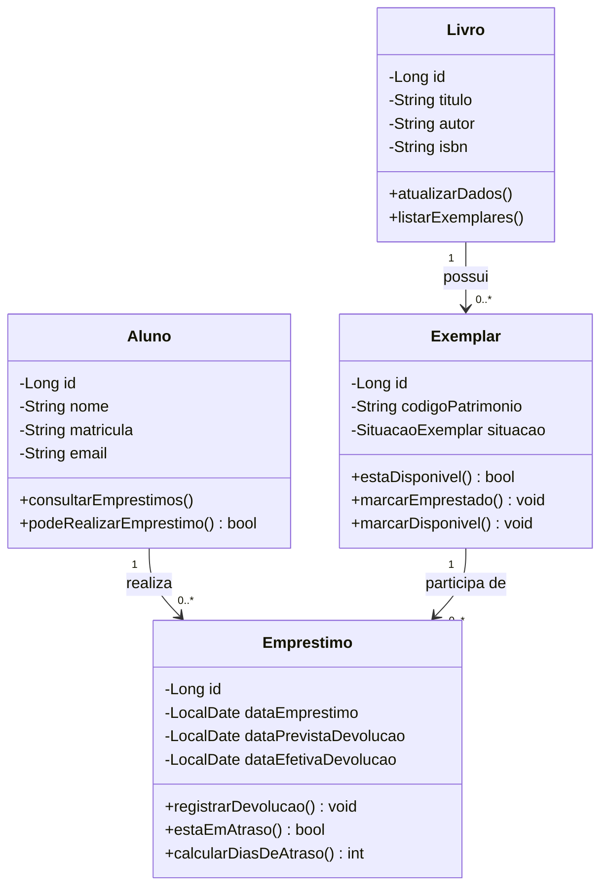

**Discussão — Todo substantivo deve virar classe?**  
Não. Os substantivos ajudam a levantar candidatos a classes, mas cada candidato precisa ser analisado. Um termo pode representar um atributo, um valor, uma regra, um papel ou apenas parte da descrição. Uma classe é adequada quando representa um conceito relevante do domínio, possui identidade ou comportamento próprio, ou concentra informações e responsabilidades que merecem ser modeladas separadamente. Por exemplo, a expressão “data do empréstimo” indica um atributo de `Emprestimo`, e não necessariamente uma classe independente.

## Exercício 3 — Anatomia de uma classe UML

**a)** Os três compartimentos representam, respectivamente, o nome da classe, seus atributos e suas operações (métodos).

**b)** Atributos representam os dados e o estado mantido pelos objetos. Operações representam os comportamentos ou serviços que os objetos oferecem e que podem alterar ou consultar esse estado.

**c)** `+` indica visibilidade pública: o membro pode ser acessado por outras classes conforme as regras da linguagem. `-` indica visibilidade privada: o acesso é restrito à própria classe.

**d)** O tipo após os dois-pontos indica o tipo de dado de um atributo ou o tipo de retorno de uma operação. Nos parâmetros, também pode indicar o tipo esperado para o valor recebido.

**e)** Documentar somente atributos mostra quais dados existem, mas não esclarece quais comportamentos a classe oferece nem onde as regras devem ser executadas. As operações ajudam a compreender as responsabilidades e a distribuição do comportamento entre os objetos.

**f)** Encapsulamento consiste em proteger o estado interno e disponibilizar formas controladas de interação. A visibilidade contribui para isso: atributos privados não são modificados livremente por qualquer classe, e métodos públicos expõem apenas as operações necessárias. Dessa forma, a própria classe pode validar alterações e preservar suas regras.

---

# Parte 2 — Relacionamentos entre classes

## Exercício 4 — Associação e multiplicidade

### Diagrama de classes

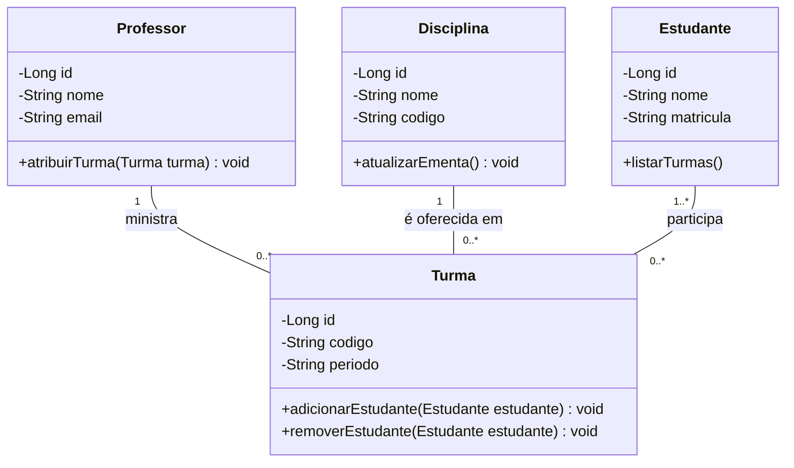

A relação entre `Professor` e `Turma` indica que cada turma possui exatamente um professor responsável, enquanto um professor pode ministrar nenhuma ou várias turmas. A relação entre `Disciplina` e `Turma` indica que cada turma pertence a uma disciplina e que uma disciplina pode ser oferecida em várias turmas. Entre `Estudante` e `Turma`, a relação é muitos-para-muitos: uma turma possui um ou mais estudantes, e um estudante pode participar de nenhuma ou várias turmas.

### Significado das multiplicidades

- `1`: exatamente uma ocorrência obrigatória.
- `0..1`: nenhuma ou uma ocorrência; a relação é opcional e singular.
- `0..*`: nenhuma, uma ou várias ocorrências.
- `1..*`: pelo menos uma ocorrência, podendo haver várias.

As multiplicidades orientam as restrições que precisam ser garantidas no código e no banco de dados. Por exemplo, a obrigatoriedade de um professor responsável exige que uma turma não seja persistida sem essa referência. Já a relação muitos-para-muitos entre estudantes e turmas normalmente exige uma tabela associativa, como `matricula_turma`, com as chaves das duas entidades.

## Exercício 5 — Associação, agregação e composição

**a) Relacionamento adequado em cada cenário**

- **Cenário A — Universidade e Departamento:** agregação. O departamento está relacionado à universidade, mas possui identidade e pode continuar existindo caso seja transferido para outra instituição.
- **Cenário B — Pedido e Item:** composição. O item pertence exclusivamente a um pedido e não possui significado independente no cenário descrito.
- **Cenário C — Professor e Disciplina:** associação. O professor ministra disciplinas, mas nenhuma das classes é parte constitutiva da outra.

**b) Diferenças**

- **Associação:** representa uma relação entre objetos. Não estabelece, por si só, propriedade ou dependência de ciclo de vida.
- **Agregação:** é uma associação todo-parte fraca. A parte mantém identidade própria e pode existir independentemente do todo.
- **Composição:** é uma relação todo-parte forte. A parte pertence ao composto e seu ciclo de vida está vinculado ao ciclo de vida do todo, conforme as regras do domínio.

**c)** Em uma composição, quando o objeto composto deixa de existir, suas partes também deixam de existir no contexto daquele composto, pois não possuem ciclo de vida independente.

**d)** Uma referência entre objetos não significa necessariamente propriedade ou dependência de ciclo de vida. Utilizar composição sem essa condição cria restrições artificiais e pode levar a exclusões indevidas. A escolha deve refletir as regras reais de identidade, propriedade e existência dos objetos.

### Diagramas dos três cenários

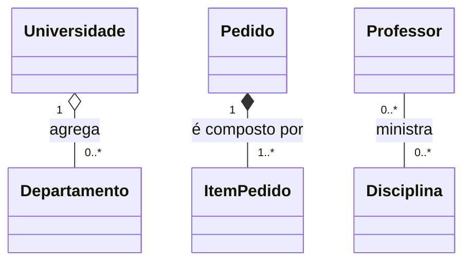

A agregação da universidade permite que um departamento seja transferido. Na composição, os itens são partes exclusivas do pedido. Na associação entre professor e disciplina, ambos continuam possuindo identidade e ciclo de vida próprios.

## Exercício 6 — Herança e generalização

**a) Atributos da superclasse**  
A classe abstrata `Pagamento` deve concentrar os atributos comuns: `id`, `valor`, `data` e `situacao`.

**b) Comportamentos compartilhados**  
Podem ser definidos na superclasse comportamentos como `consultarSituacao()`, `validarValor()` e operações de ciclo de vida que sejam realmente comuns. Uma operação `processar()` pode ser abstrata, obrigando cada modalidade a implementar seu próprio processamento.

**c) Comportamentos específicos**

- `PagamentoPix`: gerar ou consultar dados do Pix e confirmar o pagamento por meio de retorno da instituição financeira.
- `PagamentoCartao`: solicitar autorização, informar quantidade de parcelas e tratar o resultado da autorização.
- `PagamentoBoleto`: gerar código de barras ou linha digitável, definir vencimento e registrar a confirmação do pagamento.

**d) Diagrama de generalização**

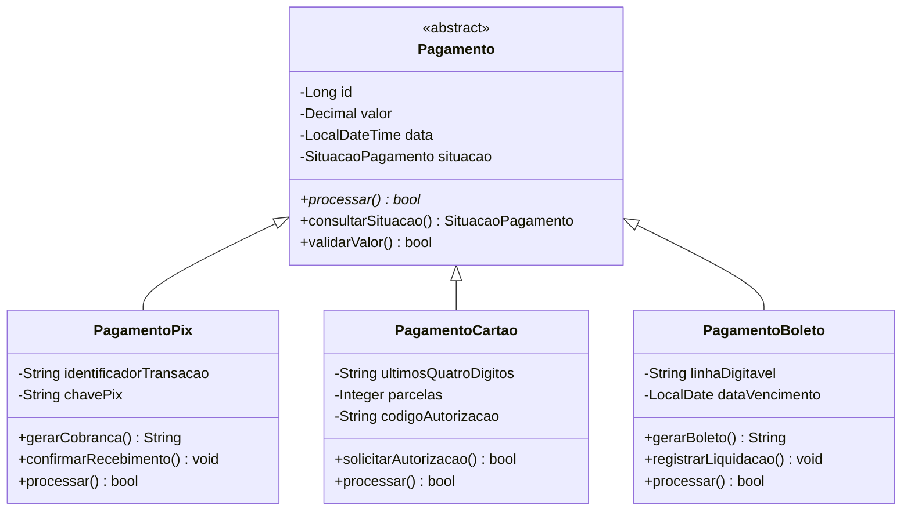

**e) Herança e composição**  
Herança representa uma relação de especialização: uma classe derivada é um tipo da classe-base e herda seus atributos e comportamentos. Composição representa uma relação todo-parte, na qual um objeto é constituído por outros objetos com ciclo de vida dependente.

**f) Quando a herança pode prejudicar a evolução?**  
Quando é utilizada apenas para reutilizar código, sem uma relação conceitual consistente de “é um”. Hierarquias profundas, subclasses excessivamente dependentes da implementação da superclasse e mudanças na classe-base que quebram as derivadas aumentam o acoplamento. Quando o comportamento varia de forma dinâmica, composição e delegação podem ser alternativas mais flexíveis.

---

# Parte 3 — Responsabilidades e qualidade do projeto

## Exercício 7 — Classes anêmicas e responsabilidades

**a)** `Pedido` representa um pedido do domínio e deve manter seus dados e garantir as regras que protegem seu estado, como não permitir alterações depois da confirmação.

**b)** `PedidoService`, no exemplo, coordena o caso de uso de pedidos. Pode consultar repositórios, chamar serviços externos e controlar a sequência das operações. Ele não deve, porém, concentrar indiscriminadamente todas as regras que pertencem ao próprio pedido.

**c)** Podem ser comportamentos de `Pedido`: `adicionarItem()`, `removerItem()`, `calcularTotal()`, `confirmar()` e `cancelar()`. Esses métodos conseguem proteger invariantes do próprio objeto, como exigir itens para confirmar e impedir alterações em pedidos confirmados.

**d)** Uma única classe de serviço com todas as regras tende a acumular responsabilidades diferentes, tornando-se difícil de compreender, testar e modificar. Também pode fazer com que as entidades sejam estruturas passivas e que as regras fiquem espalhadas ou centralizadas em excesso.

**e) Distribuição proposta**

- `Pedido`: mantém itens, estado e total; valida as transições permitidas.
- `ItemPedido`: mantém quantidade e preço unitário registrado no momento da inclusão; calcula subtotal.
- `PedidoService`: coordena o caso de uso, consulta repositórios e solicita verificações de estoque.
- `PoliticaDesconto`: aplica a política de desconto autorizada quando o cálculo depende de uma regra de domínio separada.
- `PedidoRepository`: contrato de persistência do pedido.

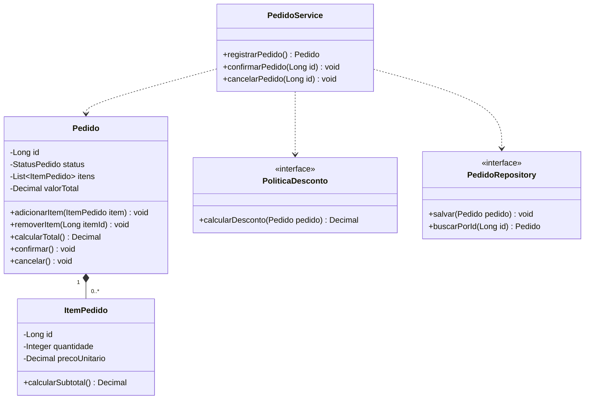

A entidade mantém as regras relacionadas ao seu próprio estado. O serviço de aplicação coordena a execução, enquanto uma política de domínio pode encapsular uma regra de desconto que não pertence exclusivamente a uma única entidade.

## Exercício 8 — Coesão e acoplamento

**a)** `SistemaManager` concentra operações de áreas diferentes: clientes, produtos, frete, pagamentos, relatórios, autenticação e comunicação. Isso caracteriza baixa coesão e uma classe com responsabilidades excessivas.

**b) Coesão**  
É o grau de relação entre as responsabilidades de uma classe ou módulo. Uma classe com alta coesão executa atividades relacionadas a um objetivo bem definido.

**c) Acoplamento**  
É o nível de dependência entre classes ou módulos. Quanto maior o acoplamento, maior a possibilidade de uma mudança em um componente exigir alterações em outros. Um projeto adequado busca dependências necessárias, explícitas e controladas.

**d)** A distribuição inadequada aumenta o impacto das mudanças, dificulta a identificação de defeitos e torna os testes mais complexos, pois uma classe pode exigir muitas dependências para ser testada. Também aumenta o risco de alterações em uma funcionalidade afetarem outras sem relação direta.

**e) Reorganização proposta**

| Classe | Responsabilidade |
|---|---|
| `ClienteService` | Cadastrar e atualizar clientes. |
| `ProdutoService` | Atualizar e consultar produtos. |
| `FreteService` | Calcular o frete conforme endereço, peso e política aplicável. |
| `PagamentoService` | Registrar e acompanhar pagamentos. |
| `RelatorioService` | Consultar dados e emitir relatórios. |
| `AutenticacaoService` | Autenticar usuários e validar credenciais. |
| `NotificacaoService` | Enviar e-mails e outras notificações. |

**f) Diagrama de classes simplificado**

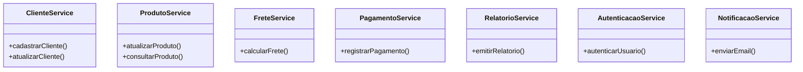

Cada classe passa a ter um objetivo mais delimitado, facilitando testes unitários, manutenção e evolução independente das funcionalidades.

## Exercício 9 — Da sequência para as classes

**a) Participantes que podem virar classes concretas**  
`TelaPedido`, `PedidoController`, `PedidoService` e uma implementação de `PedidoRepository` podem ser classes concretas. `Cliente` também pode ser uma entidade de domínio, mas o ator externo representado como cliente na sequência não precisa ser a mesma classe: ele pode ser um usuário ou vendedor que opera a tela. O repositório pode ser representado inicialmente por uma interface e depois por uma implementação concreta.

**b) Distribuição de responsabilidades**

- **Interface:** `TelaPedido`, responsável por apresentar informações e receber dados do usuário.
- **Aplicação:** `PedidoController` recebe a requisição e `PedidoService` coordena o caso de uso.
- **Domínio:** `Pedido`, `ItemPedido`, `Cliente` e demais conceitos que representam as regras de negócio.
- **Infraestrutura:** implementação concreta do repositório e acesso ao banco de dados.

**c) Operações identificáveis pelas mensagens**  
Podem ser identificadas operações como `exibirFormulario()`, `enviarDadosPedido()`, `registrarPedido()`, `validarPedido()`, `salvar()` e `buscarPorId()`. Os nomes definitivos devem refletir as responsabilidades e o vocabulário do domínio.

**d)** O Diagrama de Sequência pode sugerir atributos quando uma mensagem transporta dados ou quando um objeto precisa armazenar determinado estado. Entretanto, ele não é suficiente para descobrir todos os atributos. É necessário analisar as regras, os conceitos do domínio e as informações que precisam ser mantidas.

**e) Diagrama de classes proposto**

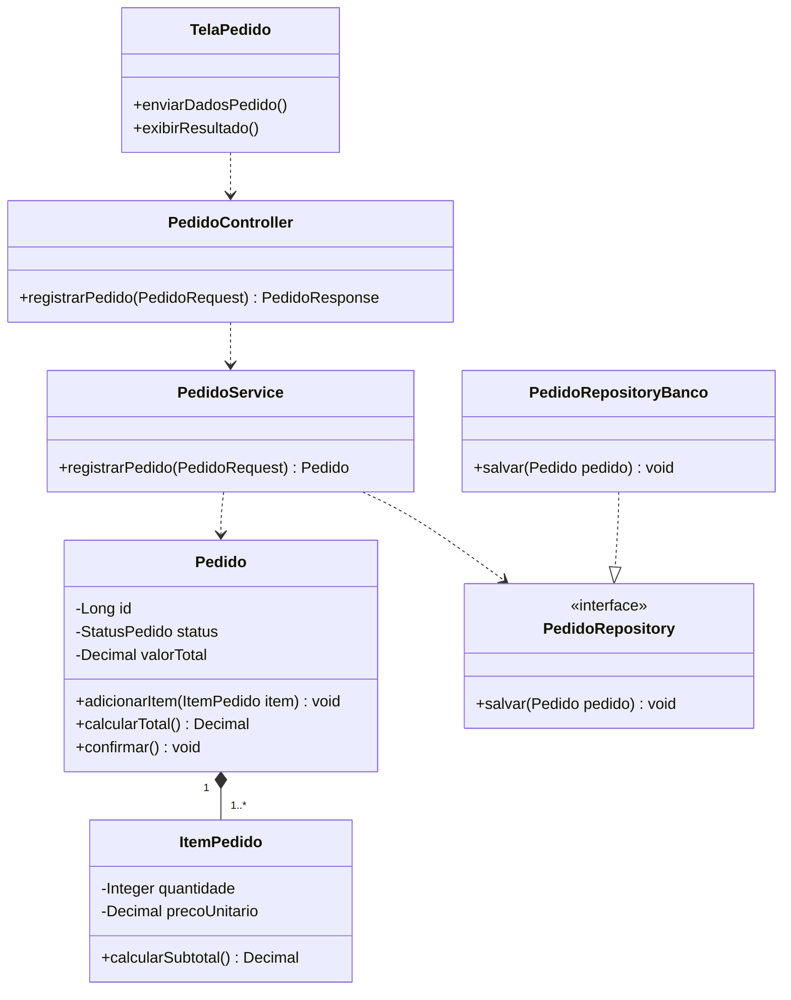

**f)** Nem todo participante de uma sequência pertence ao domínio. Telas, controladores, adaptadores e repositórios são elementos técnicos ou de aplicação. O Diagrama de Classes do domínio deve priorizar os conceitos e regras do negócio, enquanto um diagrama arquitetural mais amplo pode incluir também os componentes técnicos.

---

# Parte 4 — Arquitetura de software

## Exercício 10 — Organização em camadas

### Classificação das responsabilidades

| Item | Responsabilidade | Camada |
|---|---|---|
| 1 | Receber requisições HTTP | Apresentação/Interface |
| 2 | Validar regras de negócio | Domínio |
| 3 | Coordenar a execução de um Caso de Uso | Aplicação |
| 4 | Consultar registros no banco de dados | Infraestrutura |
| 5 | Representar uma entidade do domínio | Domínio |
| 6 | Converter dados recebidos em objetos | Apresentação/Interface, quando converte a requisição em DTO; a conversão de DTO em comando de caso de uso pode ficar na aplicação |
| 7 | Persistir alterações | Infraestrutura |
| 8 | Retornar uma resposta HTTP | Apresentação/Interface |

**a) Finalidade de cada camada**

- **Apresentação/Interface:** recebe interações externas, interpreta requisições, valida aspectos de formato e devolve respostas. Pode conter controladores, DTOs e adaptadores de entrada.
- **Aplicação:** coordena casos de uso, controla a sequência de operações e aciona as regras e portas necessárias para concluir uma funcionalidade.
- **Domínio:** contém entidades, objetos de valor, serviços e regras centrais do negócio. Deve ser independente de detalhes de interface e de persistência.
- **Infraestrutura:** implementa detalhes técnicos, como acesso ao banco de dados, comunicação com serviços externos, envio de e-mails e integração com frameworks.

**b) Exemplos de classes**

| Camada | Classes possíveis |
|---|---|
| Apresentação | `PedidoController`, `PedidoRequest`, `PedidoResponse` |
| Aplicação | `RegistrarPedidoService`, `CancelarPedidoService` |
| Domínio | `Pedido`, `ItemPedido`, `PoliticaDesconto` |
| Infraestrutura | `JpaPedidoRepository`, `EmailAdapter`, `ConfiguracaoBanco` |

**c)** Camada lógica é uma divisão conceitual de responsabilidades e dependências. Diretório físico é a organização dos arquivos no projeto. Uma camada pode estar distribuída em mais de um pacote, e um pacote não garante, sozinho, que a separação arquitetural esteja correta.

**d)** Não. A arquitetura não exige exatamente quatro diretórios. As camadas são responsabilidades lógicas e podem ser organizadas em pacotes por camadas, por funcionalidades ou em uma combinação das duas abordagens.

**e)** A separação facilita a manutenção porque limita o impacto das mudanças. Uma alteração no banco de dados, por exemplo, tende a ficar concentrada na infraestrutura, sem exigir que as entidades do domínio conheçam detalhes de SQL ou de um framework de persistência.

## Exercício 11 — Controller, Service, Entity e Repository

**a) Responsabilidade de cada classe**

- `ProdutoController`: recebe requisições HTTP, valida aspectos de entrada, chama o caso de uso e monta a resposta HTTP.
- `ProdutoService`: coordena o caso de uso, aplicando a sequência necessária para consultar, cadastrar ou atualizar produtos.
- `Produto`: representa o produto no domínio, seus atributos e comportamentos, como validar uma alteração de preço.
- `ProdutoRepository`: define operações de acesso e persistência de produtos, sem expor detalhes do banco para o domínio ou para a aplicação.

**b)** Quem recebe a requisição HTTP é `ProdutoController`.

**c)** Quem coordena o Caso de Uso é `ProdutoService`.

**d)** Quem representa os conceitos e comportamentos do domínio é `Produto`.

**e)** Quem oferece o contrato de acesso aos dados é `ProdutoRepository`; sua implementação concreta realiza a comunicação com o banco de dados.

**f)** A entidade não deve depender do controlador HTTP porque isso misturaria regras de negócio com detalhes de transporte e apresentação. Uma entidade deve poder ser utilizada em testes, processos internos ou interfaces diferentes sem conhecer requisições, respostas ou códigos HTTP.

**g) Diagrama de classes e dependências**

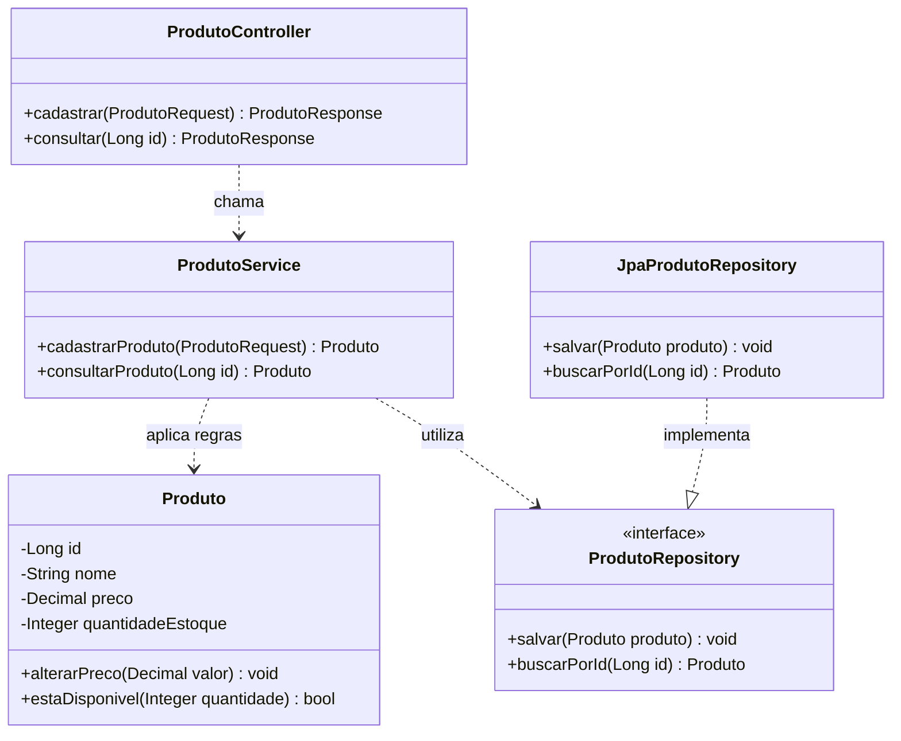

A aplicação depende da abstração `ProdutoRepository`. A infraestrutura fornece `JpaProdutoRepository`, que implementa o contrato. Assim, a regra de negócio não fica presa a uma tecnologia específica de persistência.

## Exercício 12 — Dependências inadequadas

**a) Problemas existentes**  
O controlador concentra regras de negócio, como descontos, estoque e preço, além de acessar diretamente o repositório. Isso mistura responsabilidades de interface, aplicação e domínio. A solução fica mais difícil de testar e de reutilizar, pois as regras ficam vinculadas ao fluxo HTTP.

**b)** O acesso direto ao repositório pelo controlador não é necessariamente incorreto em todo contexto. Em aplicações muito simples, uma consulta direta e sem regra de negócio pode ser aceitável. Entretanto, quando há regras, validações ou coordenação de várias operações, é mais adequado utilizar um serviço de aplicação. A decisão deve considerar a complexidade e a consistência arquitetural do projeto.

**c) Reorganização**  
O controlador deve receber a requisição e delegar o caso de uso a `ProdutoService`. O serviço deve consultar o repositório e utilizar os objetos ou serviços do domínio para validar estoque e preço. O repositório deve expor uma abstração, implementada pela infraestrutura.

**d) O que pertence ao domínio?**  
Regras como disponibilidade de estoque, limites de quantidade, cálculo de preço e critérios de desconto. A entidade `Produto` pode proteger as regras sobre seus próprios dados; regras que envolvam vários conceitos podem ficar em serviços de domínio ou políticas específicas.

**e) O que pertence à aplicação?**  
A coordenação do caso de uso: receber os dados, consultar o produto, solicitar a aplicação das regras, persistir alterações e produzir o resultado da operação. A aplicação orquestra, mas não deve substituir as regras do domínio.

**f) Diagrama da solução**

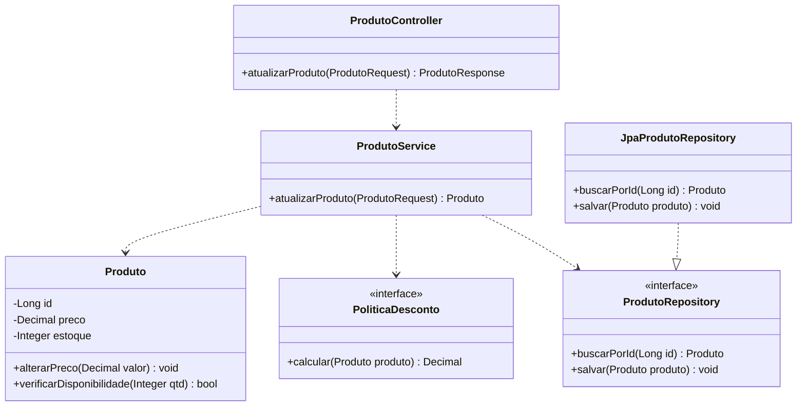

A dependência de entrada é direcionada ao serviço de aplicação. A implementação concreta do repositório fica na infraestrutura e não é conhecida pelo controlador.

---

# Parte 5 — Organização de diretórios e documentação

## Exercício 13 — Estrutura de diretórios

**a) Dificuldades da estrutura inicial**  
A concentração de todas as classes em um único diretório dificulta localizar arquivos e perceber os limites de responsabilidade. Com o crescimento, o pacote tende a ficar desorganizado, aumenta o risco de dependências indevidas e torna mais difícil separar equipes ou módulos.

**b) Proposta de organização por camadas**

```text
src/main/java/br/edu/sistema/
├── controller/
│   ├── ClienteController.java
│   ├── ProdutoController.java
│   └── PedidoController.java
├── application/
│   ├── ClienteService.java
│   ├── ProdutoService.java
│   └── PedidoService.java
├── domain/
│   ├── Cliente.java
│   ├── Produto.java
│   └── Pedido.java
└── infrastructure/
    └── persistence/
        ├── ClienteRepositoryJpa.java
        ├── ProdutoRepositoryJpa.java
        └── PedidoRepositoryJpa.java
```

**c) Proposta de organização por funcionalidades/módulos**

```text
src/main/java/br/edu/sistema/
├── cliente/
│   ├── Cliente.java
│   ├── ClienteController.java
│   ├── ClienteService.java
│   └── ClienteRepository.java
├── produto/
│   ├── Produto.java
│   ├── ProdutoController.java
│   ├── ProdutoService.java
│   └── ProdutoRepository.java
└── pedido/
    ├── Pedido.java
    ├── PedidoController.java
    ├── PedidoService.java
    └── PedidoRepository.java
```

Em um projeto real, cada módulo também pode subdividir seus arquivos internamente por responsabilidade, mantendo as interfaces e implementações de infraestrutura separadas.

**d) Comparação**

| Critério | Organização por camadas | Organização por funcionalidades |
|---|---|---|
| Critério principal | Tipo de responsabilidade técnica | Funcionalidade ou conceito de negócio |
| Localização | Classes semelhantes ficam juntas | Classes de uma funcionalidade ficam próximas |
| Vantagem | Torna explícita a separação técnica | Facilita entender e alterar uma funcionalidade completa |
| Desvantagem | Uma funcionalidade pode exigir navegar por vários diretórios | Sem subdivisão interna, pode misturar responsabilidades no módulo |
| Adequação | Projetos pequenos ou equipes organizadas por camada | Sistemas com módulos de negócio bem definidos |

**e)** A organização por funcionalidades facilita localizar tudo relacionado a `Registrar Pedido`, pois as classes do módulo `pedido` ficam agrupadas.

**f)** Para um sistema de médio porte, é adequada uma organização por funcionalidades com separação interna das responsabilidades. Assim, o código mantém a proximidade dos elementos relacionados ao negócio sem abandonar a distinção entre interface, aplicação, domínio e infraestrutura.

## Exercício 14 — Organização por camadas × funcionalidades

**a) Critério de cada organização**  
A Estrutura A agrupa os arquivos conforme a camada técnica: controladores, serviços, repositórios e modelos. A Estrutura B agrupa os arquivos pela funcionalidade: cliente e pedido, por exemplo.

**b) Vantagens e desvantagens**

- **Estrutura A — por camadas:** facilita encontrar todas as classes de uma mesma responsabilidade técnica e pode padronizar projetos pequenos. Em contrapartida, uma alteração em uma funcionalidade pode exigir navegar por vários diretórios.
- **Estrutura B — por funcionalidades:** deixa os elementos relacionados a um caso de negócio próximos, favorecendo modularidade e localização. Como desvantagem, módulos muito grandes podem acumular classes de naturezas diferentes caso não tenham organização interna.

**c)** A organização por camadas destaca a arquitetura técnica. A organização por funcionalidades destaca os limites do negócio. Ambas podem ser compreensíveis quando os nomes e as dependências são consistentes.

**d)** Não. Diretórios mostram a organização física dos arquivos, mas não garantem baixo acoplamento, alta coesão ou dependências adequadas. Uma aplicação pode ter pastas chamadas `controller`, `service` e `repository` e ainda assim possuir regras de negócio no controlador ou dependências circulares.

**e) Combinação proposta**  
Utilizar módulos por funcionalidade e, dentro de cada módulo, separar as responsabilidades. Por exemplo:

```text
src/main/java/br/edu/sistema/
└── pedido/
    ├── domain/
    │   ├── Pedido.java
    │   └── ItemPedido.java
    ├── application/
    │   ├── PedidoService.java
    │   └── PedidoRepository.java
    ├── interfaceadapter/
    │   └── PedidoController.java
    └── infrastructure/
        └── JpaPedidoRepository.java
```

Essa organização combina a proximidade entre elementos do mesmo negócio com a separação de responsabilidades internas.

## Exercício 15 — Documentação das classes

Exemplo de documentação para `PedidoService`, considerando o caso de uso de registro de pedidos:

| Campo | Descrição |
|---|---|
| Classe | `PedidoService` |
| Responsabilidade | Coordenar o registro de pedidos, validar as condições do caso de uso, solicitar verificações de domínio e persistir o resultado. |
| Operações | `registrarPedido(PedidoRequest request): PedidoResponse` — recebe os dados do pedido, coordena as validações e retorna a identificação e o estado do pedido registrado. |
| Parâmetros | `PedidoRequest`: identificador do cliente e lista de itens com produto e quantidade. |
| Resultado esperado | `PedidoResponse` com identificador, estado e total do pedido; em caso de falha, retornar erro de validação ou exceção de negócio adequada. |
| Dependências | `PedidoRepository`, porta de consulta de clientes, serviço/porta de disponibilidade de estoque e política de desconto, quando aplicável. |
| RN relacionadas | RN01 — pedido associado a um cliente; RN02 — ao confirmar, deve possuir pelo menos um item; RN03 — não adicionar produto sem estoque suficiente; RN04 — total considera subtotais e descontos autorizados; RN05 — pedido confirmado não pode ter itens alterados; RN06 — somente pedido ainda não enviado pode ser cancelado. |
| RF relacionadas | RF01 — registrar pedido; RF02 — adicionar produtos ao pedido; RF03 — calcular total; RF04 — confirmar pedido; RF05 — cancelar pedido. |
| UC relacionados | UC01 — Registrar Pedido; UC02 — Confirmar Pedido; UC03 — Cancelar Pedido. |

**Diferença entre documentar uma classe e documentar um Caso de Uso**  
A documentação de uma classe descreve sua responsabilidade, seus atributos, operações, parâmetros, resultados e dependências. A documentação de um Caso de Uso descreve o objetivo de um ator, as condições para iniciar e concluir a funcionalidade, o fluxo principal, os caminhos alternativos e as regras de negócio relacionadas. A classe explica uma parte da solução; o Caso de Uso explica o comportamento esperado do sistema sob a perspectiva do usuário.

---

# Parte 6 — Integração entre análise, projeto e arquitetura

## Exercício 16 — Rastreabilidade até as classes

A regra e os artefatos podem ser relacionados da seguinte forma:

```text
RN01 — Um pedido não pode ser confirmado quando algum produto estiver indisponível.
  ↓
RF01 — O sistema deve permitir registrar pedidos.
  ↓
UC01 — Registrar Pedido.
  ↓
Diagrama de Sequência — consultar disponibilidade antes da confirmação.
  ↓
Classes — Pedido, ItemPedido, PedidoService, EstoqueService e PedidoRepository.
  ↓
Módulos — pedido/ e produto/ (ou estoque/).
```

**a) Classes necessárias**

- `Pedido`: representa o pedido e controla seu estado e confirmação.
- `ItemPedido`: representa cada produto e sua quantidade no pedido.
- `PedidoService`: coordena o caso de uso de registro e confirmação.
- `EstoqueService`: consulta a disponibilidade dos produtos.
- `PedidoRepository`: contrato para persistir e recuperar pedidos.
- `ProdutoRepository` ou `EstoqueRepository`: permite consultar os saldos de estoque, por meio de uma abstração.

**b)** `EstoqueService` verifica se existe quantidade suficiente para atender aos itens. A verificação deve consultar a informação atualizada de estoque, e não confiar somente em dados recebidos pela interface.

**c)** `Pedido` executa a operação de confirmação e protege suas invariantes. `PedidoService` coordena a operação: verifica as condições, solicita a confirmação à entidade e persiste o pedido.

**d)** A RN01 aparece na sequência como uma verificação de disponibilidade antes da confirmação. Se algum produto estiver indisponível, a confirmação é interrompida e o sistema informa a falha. Se todos estiverem disponíveis, o pedido pode prosseguir.

**e)** A rastreabilidade pode ser documentada em uma matriz:

| Regra | Requisito | Caso de uso | Classes/operações relacionadas |
|---|---|---|---|
| RN01 | RF01 | UC01 — Registrar Pedido | `EstoqueService.verificarDisponibilidade()`, `Pedido.confirmar()`, `PedidoService.confirmarPedido()` |

Essa matriz permite verificar onde cada regra é implementada e quais elementos precisam ser revistos quando uma regra mudar.

## Exercício 17 — Arquitetura de um sistema de estoque

### a) Classes do domínio

- `Produto`: identifica o produto cadastrado e seus dados descritivos.
- `Estoque`: mantém a quantidade disponível de um produto e protege a regra de que o saldo não pode ficar negativo.
- `MovimentacaoEstoque`: registra cada entrada ou saída realizada, incluindo quantidade, data, tipo e responsável.
- `Usuario`: representa a pessoa que solicita ou realiza uma movimentação.
- `TipoMovimentacao`: enumeração com os valores `ENTRADA` e `SAIDA`.

### b) Atributos e operações

| Classe | Atributos | Operações |
|---|---|---|
| `Produto` | `id`, `nome`, `descricao`, `codigo` | `atualizarDados()`, `ativar()`, `inativar()` |
| `Estoque` | `id`, `quantidadeAtual`, `produto` | `registrarEntrada(qtd)`, `registrarSaida(qtd)`, `consultarQuantidade()`, `estaDisponivel(qtd)` |
| `MovimentacaoEstoque` | `id`, `tipo`, `quantidade`, `dataHora`, `produto`, `usuario` | `validar()`; seus dados devem ser preservados como registro histórico |
| `Usuario` | `id`, `nome`, `login`, `ativo`, `perfil` | `podeRegistrarMovimentacao()`, `ativar()`, `inativar()` |

### c) Associações e multiplicidades

- Cada `Produto` possui um registro de `Estoque`; cada registro de estoque está associado a um produto: `Produto 1 — 1 Estoque`.
- Um `Produto` pode ter várias `MovimentacaoEstoque` ao longo do tempo: `Produto 1 — 0..* MovimentacaoEstoque`.
- Cada movimentação é realizada por um `Usuario`, e um usuário pode realizar várias movimentações: `Usuario 1 — 0..* MovimentacaoEstoque`.

### d) Diagrama de classes do domínio

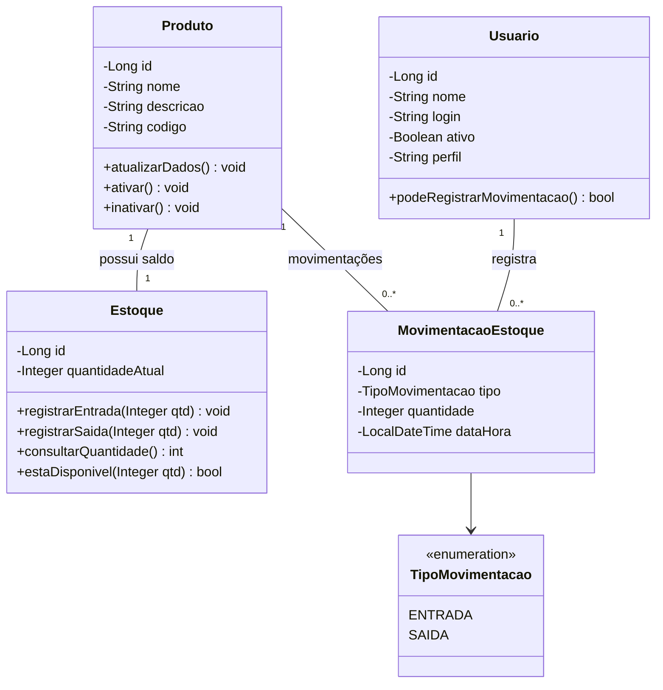

A movimentação não deve ser apagada quando o saldo é atualizado, pois é o histórico que permite auditoria e emissão de relatórios. A atualização do saldo e a gravação da movimentação devem ocorrer na mesma transação para evitar inconsistência.

### e) Componentes de aplicação

- `CadastrarProdutoService`: coordena o cadastro e a atualização de produtos.
- `RegistrarEntradaService`: valida a solicitação, registra a entrada no estoque, gera a movimentação e persiste as alterações.
- `RegistrarSaidaService`: verifica autorização e disponibilidade, registra a saída e gera a movimentação.
- `ConsultarEstoqueService`: consulta os saldos disponíveis.
- `EmitirRelatorioMovimentacoesService`: reúne movimentações conforme período, produto ou usuário.

### f) Infraestrutura

A infraestrutura pode conter implementações dos repositórios (`JpaProdutoRepository`, `JpaEstoqueRepository` e `JpaMovimentacaoRepository`), configuração do banco de dados, adaptadores para autenticação, mecanismos de geração de relatórios e bibliotecas de exportação de arquivos. Esses componentes implementam os detalhes técnicos sem colocar SQL ou dependências de framework nas entidades do domínio.

### g) Proposta de diretórios

```text
src/main/java/br/edu/sistema/
├── produto/
│   ├── domain/
│   │   └── Produto.java
│   ├── application/
│   │   └── CadastrarProdutoService.java
│   ├── interfaceadapter/
│   │   └── ProdutoController.java
│   └── infrastructure/
│       └── JpaProdutoRepository.java
├── estoque/
│   ├── domain/
│   │   ├── Estoque.java
│   │   ├── MovimentacaoEstoque.java
│   │   └── TipoMovimentacao.java
│   ├── application/
│   │   ├── RegistrarEntradaService.java
│   │   ├── RegistrarSaidaService.java
│   │   ├── ConsultarEstoqueService.java
│   │   └── EmitirRelatorioMovimentacoesService.java
│   ├── interfaceadapter/
│   │   └── EstoqueController.java
│   └── infrastructure/
│       ├── JpaEstoqueRepository.java
│       └── JpaMovimentacaoRepository.java
└── usuario/
    ├── domain/
    │   └── Usuario.java
    ├── application/
    │   └── AutorizacaoService.java
    └── infrastructure/
        └── JpaUsuarioRepository.java
```

### h) Aplicação das regras de negócio

- **RN01 — O estoque não pode ficar negativo:** é protegida pela entidade `Estoque`, principalmente em `registrarSaida(qtd)`. A operação deve rejeitar quantidade superior ao saldo disponível.
- **RN02 — Toda entrada deve gerar uma movimentação:** é coordenada por `RegistrarEntradaService`. A alteração do saldo e a criação de `MovimentacaoEstoque` devem ser persistidas na mesma transação.
- **RN03 — Toda saída deve gerar uma movimentação:** é coordenada por `RegistrarSaidaService`, também com atualização do saldo e registro histórico atômicos.
- **RN04 — Somente usuários autorizados podem registrar movimentações:** é verificada pelo componente de aplicação de autorização antes de permitir a operação. O usuário responsável é registrado na movimentação para auditoria.

---

# Parte 7 — Master Class: projeto completo

## Exercício 18 — Do Caso de Uso à arquitetura

# Sistema de Gerenciamento de Pedidos

## Etapa 1 — Análise

### Requisitos funcionais

| Código | Requisito funcional |
|---|---|
| RF01 | O sistema deve permitir cadastrar clientes. |
| RF02 | O sistema deve permitir cadastrar produtos. |
| RF03 | O sistema deve permitir consultar produtos e suas informações de disponibilidade. |
| RF04 | O sistema deve permitir registrar pedidos associados a um cliente. |
| RF05 | O sistema deve permitir adicionar produtos e quantidades a um pedido. |
| RF06 | O sistema deve calcular o total do pedido com base nos subtotais e nos descontos autorizados. |
| RF07 | O sistema deve permitir confirmar pedidos que atendam às regras de negócio. |
| RF08 | O sistema deve permitir cancelar pedidos que ainda não foram enviados. |
| RF09 | O sistema deve permitir consultar o histórico de pedidos de um cliente. |

### Requisitos não funcionais relevantes

- **RNF01 — Segurança:** as funcionalidades devem exigir autenticação e respeitar as permissões de cada perfil, principalmente para concessão de descontos e confirmação/cancelamento.
- **RNF02 — Integridade:** as operações de confirmação e atualização de estoque devem preservar a consistência dos dados, utilizando transações quando necessário.
- **RNF03 — Desempenho:** consultas e operações comuns devem apresentar tempo de resposta adequado ao volume esperado de usuários e pedidos.
- **RNF04 — Rastreabilidade:** o sistema deve manter identificação, datas e histórico das alterações relevantes dos pedidos.
- **RNF05 — Manutenibilidade:** o código deve manter separação entre apresentação, aplicação, domínio e infraestrutura.
- **RNF06 — Confiabilidade:** falhas na persistência ou nas verificações não devem deixar pedidos parcialmente confirmados.

### Atores

- **Vendedor:** cadastra ou seleciona clientes, consulta produtos, registra pedidos, adiciona itens e solicita confirmação ou cancelamento conforme suas permissões.
- **Administrador:** administra cadastros e pode autorizar descontos ou operações restritas, conforme as permissões definidas pela empresa.

### Casos de Uso

| Código | Caso de Uso | Ator principal |
|---|---|---|
| UC01 | Registrar Pedido | Vendedor |
| UC02 | Cadastrar Cliente | Vendedor/Administrador |
| UC03 | Cadastrar Produto | Administrador |
| UC04 | Consultar Produtos | Vendedor |
| UC05 | Adicionar Produto ao Pedido | Vendedor |
| UC06 | Calcular Total do Pedido | Sistema, durante o registro ou alteração |
| UC07 | Confirmar Pedido | Vendedor autorizado |
| UC08 | Cancelar Pedido | Vendedor autorizado |
| UC09 | Consultar Histórico de Pedidos | Vendedor/Administrador |
| UC10 | Autorizar Desconto | Administrador |

## Etapa 2 — Especificação do UC01 — Registrar Pedido

| Campo | Especificação |
|---|---|
| Identificador | UC01 |
| Nome | Registrar Pedido |
| Objetivo | Registrar um pedido para um cliente, incluindo os produtos e quantidades solicitados, calculando seu valor e permitindo sua posterior confirmação. |
| Ator principal | Vendedor |
| Atores secundários | Administrador, quando for necessária autorização de desconto; serviços internos de estoque e persistência. |
| Pré-condições | O vendedor está autenticado e autorizado; o cliente está cadastrado e ativo; os produtos estão cadastrados. |
| Pós-condições de sucesso | O pedido é salvo associado ao cliente, contém os itens válidos informados e possui total calculado. O pedido permanece com estado `ABERTO` até ser confirmado. |
| Pós-condições de falha | O sistema não registra uma operação inválida nem deixa dados parcialmente persistidos. O usuário recebe uma mensagem que identifica o motivo da falha. |

### Fluxo principal

1. O vendedor acessa a opção de registrar pedido.
2. O sistema apresenta a possibilidade de selecionar um cliente.
3. O vendedor seleciona o cliente e informa os produtos e as quantidades desejadas.
4. O sistema verifica se o cliente existe e está ativo.
5. Para cada produto, o sistema consulta a disponibilidade em estoque.
6. Quando há quantidade suficiente, o sistema inclui o item no pedido e registra o preço unitário utilizado no momento da inclusão.
7. O sistema calcula o subtotal de cada item e atualiza o total do pedido.
8. Caso exista desconto, o sistema verifica se ele foi autorizado conforme a política definida.
9. O vendedor revisa os dados do pedido.
10. O sistema salva o pedido com estado `ABERTO` e apresenta o resumo e o identificador gerado.

### Fluxos alternativos e exceções

- **A1 — Cliente inexistente ou inativo:** o sistema informa que o cliente não pode ser utilizado e solicita a seleção de outro cliente. O pedido não é salvo.
- **A2 — Produto sem estoque suficiente:** o sistema informa a indisponibilidade ou a quantidade disponível e não inclui aquele item. O vendedor pode ajustar a quantidade ou selecionar outro produto.
- **A3 — Desconto não autorizado:** o sistema rejeita o desconto solicitado, mantém o valor sem o desconto ou solicita autorização de um administrador, conforme a política da empresa.
- **A4 — Pedido sem itens:** o sistema permite manter o pedido em edição, mas não permite confirmá-lo enquanto estiver vazio, conforme RN02.
- **E1 — Falha de persistência:** o sistema desfaz a transação, informa que não foi possível registrar o pedido e evita apresentar a operação como concluída.
- **E2 — Estoque alterado simultaneamente:** antes da confirmação, o sistema realiza uma nova verificação ou reserva atômica de estoque. Se a quantidade não estiver mais disponível, a confirmação é recusada.

### Regras de negócio relacionadas

- **RN01:** todo pedido deve estar associado a um cliente.
- **RN02:** um pedido deve possuir pelo menos um item para ser confirmado.
- **RN03:** produtos sem estoque suficiente não podem ser adicionados ao pedido.
- **RN04:** o total corresponde à soma dos subtotais, considerando descontos autorizados.
- **RN05:** pedidos confirmados não podem ter seus itens alterados.
- **RN06:** somente pedidos ainda não enviados podem ser cancelados.

### Requisitos funcionais relacionados

RF01, RF03, RF04, RF05 e RF06. A confirmação e o cancelamento são tratados diretamente pelos requisitos RF07 e RF08, relacionados aos casos de uso específicos UC07 e UC08.

## Etapa 3 — Diagrama de Sequência

O diagrama abaixo representa o registro do pedido, a verificação dos produtos e a persistência. O fragmento `loop` representa a inclusão de vários produtos; o fragmento `alt` representa as alternativas de disponibilidade. A confirmação é apresentada como uma etapa posterior, que verifica novamente as condições para evitar confirmar um pedido cujo estoque tenha mudado durante a edição.

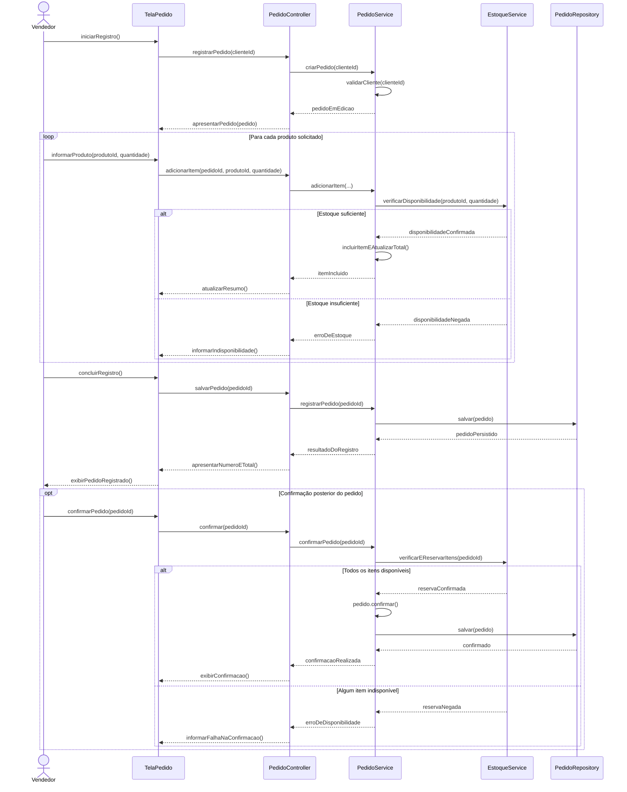

## Etapa 4 — Identificação das classes

| Classe | Camada | Responsabilidade | Atributos principais | Operações principais |
|---|---|---|---|---|
| `Cliente` | Domínio | Representar o cliente associado ao pedido. | `id`, `nome`, `documento`, `email`, `ativo` | `ativar()`, `inativar()`, `atualizarDados()` |
| `Produto` | Domínio | Representar um produto disponível para venda. | `id`, `nome`, `descricao`, `preco`, `ativo` | `alterarPreco()`, `estaAtivo()` |
| `Pedido` | Domínio | Manter o estado, os itens e o total, protegendo as regras do pedido. | `id`, `dataCriacao`, `status`, `cliente`, `itens`, `valorTotal` | `adicionarItem()`, `removerItem()`, `calcularTotal()`, `confirmar()`, `cancelar()` |
| `ItemPedido` | Domínio | Representar um produto e sua quantidade dentro do pedido. | `id`, `produto`, `quantidade`, `precoUnitario` | `calcularSubtotal()`, `alterarQuantidade()` |
| `PoliticaDesconto` | Domínio | Definir o cálculo e os critérios de desconto autorizados. | parâmetros da política, conforme a implementação | `calcularDesconto()` |
| `PedidoService` | Aplicação | Coordenar registro, confirmação e cancelamento do pedido. | dependências de repositórios e serviços | `registrarPedido()`, `adicionarItem()`, `confirmarPedido()`, `cancelarPedido()` |
| `EstoqueService` | Aplicação/porta de integração | Consultar e reservar a disponibilidade dos produtos. | dependência da consulta de estoque | `verificarDisponibilidade()`, `verificarEReservarItens()` |
| `PedidoController` | Apresentação | Receber as requisições e devolver respostas da funcionalidade de pedidos. | dependência de `PedidoService` | `registrar()`, `adicionarItem()`, `confirmar()`, `cancelar()` |
| `PedidoRepository` | Porta/contrato | Definir operações de persistência e consulta de pedidos. | — | `salvar()`, `buscarPorId()`, `buscarPorCliente()` |
| `JpaPedidoRepository` | Infraestrutura | Implementar a persistência de pedidos usando a tecnologia de banco escolhida. | dependência do contexto de persistência | Implementar `salvar()`, `buscarPorId()` e consultas |
| `ProdutoRepository` | Porta/contrato | Definir operações de consulta e persistência de produtos. | — | `buscarPorId()`, `salvar()` |
| `PedidoRequest` / `PedidoResponse` | Apresentação | Transportar dados de entrada e saída da API. | campos necessários à requisição/resposta | — |

## Etapa 5 — Diagrama de Classes

O diagrama reúne as principais entidades do domínio, contratos de persistência e componentes responsáveis pela coordenação do caso de uso.

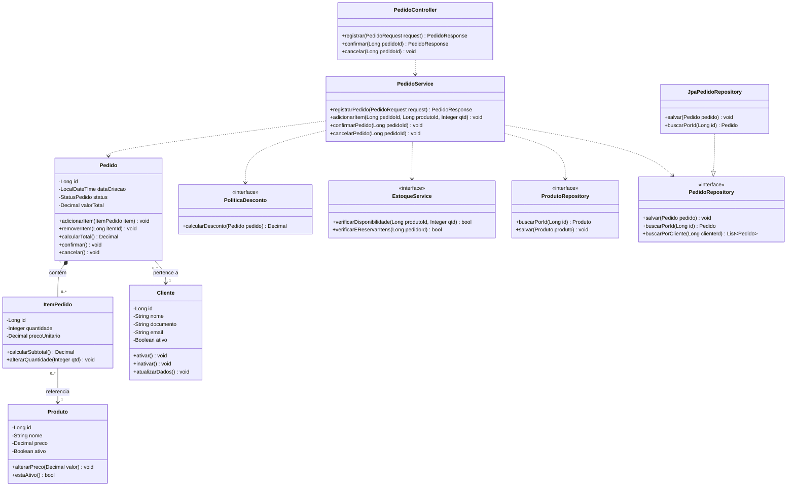

A multiplicidade `1..*` entre pedido e item expressa que um pedido confirmado precisa possuir pelo menos um item. Durante a edição, pode existir um pedido temporariamente sem itens; a regra é aplicada no método `confirmar()`. O preço unitário é registrado em `ItemPedido` para preservar o valor utilizado naquela negociação, mesmo que o preço do produto seja alterado posteriormente.

## Etapa 6 — Arquitetura

### Apresentação

Contém `PedidoController`, `ClienteController`, `ProdutoController`, DTOs e adaptadores de entrada. Sua responsabilidade é receber requisições, interpretar os dados externos e devolver respostas. Não deve calcular regras de desconto nem decidir se um pedido pode ser confirmado.

### Aplicação

Contém `PedidoService` e os serviços que implementam os casos de uso. Coordena as operações: consulta cliente e produto, solicita verificação de estoque, aplica a política de desconto quando necessário e persiste o pedido por meio de contratos. A aplicação organiza o fluxo, mas delega as regras centrais às entidades e políticas do domínio.

### Domínio

Contém `Cliente`, `Produto`, `Pedido`, `ItemPedido`, `StatusPedido` e `PoliticaDesconto`. É responsável pelas regras essenciais: associação do pedido a um cliente, existência de itens para confirmar, cálculo do total, bloqueio de alterações após confirmação e condições para cancelamento.

### Infraestrutura

Contém implementações concretas dos repositórios, mapeamentos de persistência, configuração do banco, adaptadores para o serviço de estoque e integrações externas. Implementa as abstrações utilizadas pela aplicação.

### Dependências permitidas

- A apresentação pode depender da aplicação para executar casos de uso.
- A aplicação pode depender do domínio e de contratos/portas de saída.
- O domínio não deve depender de controladores HTTP, banco de dados ou frameworks de infraestrutura.
- A infraestrutura implementa contratos definidos pelas camadas internas e pode depender dos detalhes técnicos necessários.
- O controlador não deve acessar diretamente implementações concretas de repositórios nem concentrar regras do domínio.

A divisão em camadas não obriga que todas as dependências físicas sejam sempre unidirecionais entre quatro diretórios fixos. O aspecto essencial é que as regras centrais permaneçam independentes dos detalhes externos. Por exemplo, a aplicação pode depender de uma interface `PedidoRepository`, enquanto a infraestrutura fornece a implementação dessa interface. Em tempo de execução, a implementação é utilizada, mas a regra de negócio não depende de sua tecnologia concreta.

## Etapa 7 — Estrutura de diretórios

Uma organização por funcionalidades, com divisão interna por responsabilidade, pode ser implementada da seguinte maneira:

```text
src/main/java/br/edu/sistema/
├── cliente/
│   ├── domain/
│   │   └── Cliente.java
│   ├── application/
│   │   ├── CadastrarClienteService.java
│   │   ├── ConsultarClienteService.java
│   │   └── port/
│   │       └── out/ClienteRepository.java
│   ├── interfaceadapter/
│   │   ├── ClienteController.java
│   │   ├── ClienteRequest.java
│   │   └── ClienteResponse.java
│   └── infrastructure/
│       └── persistence/JpaClienteRepository.java
│
├── produto/
│   ├── domain/
│   │   └── Produto.java
│   ├── application/
│   │   ├── CadastrarProdutoService.java
│   │   ├── ConsultarProdutoService.java
│   │   └── port/
│   │       └── out/ProdutoRepository.java
│   ├── interfaceadapter/
│   │   ├── ProdutoController.java
│   │   ├── ProdutoRequest.java
│   │   └── ProdutoResponse.java
│   └── infrastructure/
│       └── persistence/JpaProdutoRepository.java
│
├── pedido/
│   ├── domain/
│   │   ├── Pedido.java
│   │   ├── ItemPedido.java
│   │   ├── StatusPedido.java
│   │   └── PoliticaDesconto.java
│   ├── application/
│   │   ├── PedidoService.java
│   │   ├── RegistrarPedidoService.java
│   │   ├── ConfirmarPedidoService.java
│   │   ├── CancelarPedidoService.java
│   │   ├── dto/
│   │   │   ├── PedidoRequest.java
│   │   │   └── PedidoResponse.java
│   │   └── port/
│   │       └── out/
│   │           ├── PedidoRepository.java
│   │           └── EstoqueGateway.java
│   ├── interfaceadapter/
│   │   └── PedidoController.java
│   └── infrastructure/
│       ├── persistence/JpaPedidoRepository.java
│       └── integration/ProdutoEstoqueAdapter.java
│
└── shared/
    ├── exception/
    └── config/
```

### Justificativa da organização

Os módulos `cliente`, `produto` e `pedido` agrupam os elementos relacionados a cada parte do negócio. Dentro deles, as pastas separam entidades e regras de domínio, coordenação de casos de uso, interface externa e implementações técnicas. Os DTOs transportam dados entre a interface e a aplicação sem expor diretamente as entidades do domínio. As interfaces de repositório e de integração funcionam como contratos, enquanto as implementações concretas permanecem na infraestrutura.

## Etapa 8 — Documentação arquitetural

### 1. Visão geral do sistema

O Sistema de Gerenciamento de Pedidos permite administrar clientes e produtos, registrar pedidos, adicionar itens, calcular totais, confirmar ou cancelar pedidos e consultar históricos. O sistema é organizado em módulos de negócio e utiliza separação entre apresentação, aplicação, domínio e infraestrutura.

O módulo `cliente` mantém os dados e as operações relacionadas aos clientes. O módulo `produto` administra o catálogo e disponibiliza informações necessárias à consulta e à verificação de produtos. O módulo `pedido` coordena o ciclo de vida dos pedidos e garante as regras que determinam sua composição, cálculo, confirmação e cancelamento.

### 2. Decisões arquiteturais e justificativas

| Decisão | Justificativa |
|---|---|
| Organização por funcionalidades | Mantém próximos os elementos ligados a cada área do negócio e facilita localizar uma funcionalidade completa. |
| Separação interna por camadas | Evita misturar HTTP, regras de negócio, coordenação de casos de uso e persistência. |
| Entidades com comportamento | Mantém regras que protegem o estado dentro dos objetos responsáveis por elas. |
| Serviços de aplicação | Coordenam os fluxos dos casos de uso sem concentrar todas as regras nas controladoras. |
| Repositórios por interface | Permitem substituir a tecnologia de persistência sem alterar a lógica central. |
| DTOs na interface | Evitam expor diretamente as entidades e permitem controlar os dados de entrada e saída. |
| Persistência transacional | Evita estados parciais durante operações como confirmação do pedido e atualização de estoque. |
| Registro do preço no item | Preserva o valor negociado no momento da inclusão, mesmo que o preço atual do produto mude. |

### 3. Árvore de diretórios comentada

- `cliente/domain`: entidade e regras próprias de cliente.
- `cliente/application`: casos de uso de cadastro e consulta, além dos contratos necessários.
- `cliente/interfaceadapter`: controladores e DTOs de entrada e saída.
- `cliente/infrastructure`: implementação de persistência.
- `produto/domain`: entidade e regras de produto.
- `produto/application`: cadastro, consulta e contratos para acesso aos dados.
- `produto/interfaceadapter`: API e DTOs de produto.
- `produto/infrastructure`: implementação concreta do repositório e integração de estoque.
- `pedido/domain`: pedido, item, estado e políticas de domínio.
- `pedido/application`: registro, inclusão de itens, confirmação, cancelamento e contratos de saída.
- `pedido/interfaceadapter`: controlador e adaptação das requisições.
- `pedido/infrastructure`: persistência e adaptadores necessários à integração com produtos/estoque.
- `shared`: configurações e componentes genéricos realmente compartilhados, evitando transformar esse diretório em local para qualquer classe sem módulo definido.

### 4. Responsabilidades das principais classes

| Classe | Responsabilidade principal |
|---|---|
| `Cliente` | Manter dados e estado do cliente. |
| `Produto` | Manter dados do produto e regras relativas à sua validade e preço. |
| `Pedido` | Controlar itens, total e transições de estado, impedindo operações proibidas. |
| `ItemPedido` | Registrar produto, quantidade e preço unitário aplicado, calculando o subtotal. |
| `PedidoService` | Coordenar os casos de uso de pedido e chamar as dependências necessárias. |
| `EstoqueGateway` | Definir o contrato pelo qual o módulo de pedidos consulta ou solicita reserva de estoque. |
| `PedidoRepository` | Definir operações de armazenamento e consulta de pedidos. |
| `PedidoController` | Adaptar requisições externas para chamadas aos casos de uso e produzir respostas. |
| `JpaPedidoRepository` | Implementar o acesso aos dados de pedidos por meio da tecnologia escolhida. |

### 5. Diagramas de Classes e Sequência

O Diagrama de Classes e o Diagrama de Sequência apresentados nas Etapas 5 e 3 documentam, respectivamente, a estrutura estática e a colaboração temporal dos componentes. Juntos, mostram como os casos de uso são sustentados pelas classes e por suas responsabilidades.

### 6. Rastreabilidade RN–RF–UC–classes

| Regra de negócio | Requisito funcional | Caso de Uso | Classes e operações relacionadas |
|---|---|---|---|
| RN01 — pedido associado a um cliente | RF04 — registrar pedido | UC01 — Registrar Pedido | `Pedido`, `PedidoService.registrarPedido()`, `ClienteRepository.buscarPorId()` |
| RN02 — pedido precisa ter item para confirmação | RF07 — confirmar pedido | UC07 — Confirmar Pedido | `Pedido.confirmar()`, `ConfirmarPedidoService.confirmarPedido()` |
| RN03 — não adicionar produto sem estoque | RF05 — adicionar produtos | UC05 — Adicionar Produto ao Pedido | `EstoqueGateway.verificarDisponibilidade()`, `Pedido.adicionarItem()` |
| RN04 — total considera subtotais e descontos autorizados | RF06 — calcular total | UC06 — Calcular Total do Pedido | `ItemPedido.calcularSubtotal()`, `Pedido.calcularTotal()`, `PoliticaDesconto.calcularDesconto()` |
| RN05 — pedido confirmado não pode ter itens alterados | RF05 — adicionar produtos | UC05 — Adicionar Produto ao Pedido | `Pedido.adicionarItem()`, `Pedido.removerItem()` |
| RN06 — somente pedido não enviado pode ser cancelado | RF08 — cancelar pedido | UC08 — Cancelar Pedido | `Pedido.cancelar()`, `CancelarPedidoService.cancelarPedido()` |

### 7. Regras de dependência entre módulos

1. `interfaceadapter` pode chamar os serviços de `application`, mas não deve conter regras centrais de negócio.
2. `application` coordena os casos de uso e depende das entidades e políticas do domínio, além de contratos para persistência e integração.
3. `domain` não depende de controladores, DTOs HTTP, banco de dados ou frameworks de infraestrutura.
4. `infrastructure` implementa os contratos definidos pelas camadas internas e concentra detalhes de banco de dados e integrações externas.
5. O módulo `pedido` pode consultar o módulo `produto` por meio de um contrato de integração, como `EstoqueGateway`, sem fazer com que a entidade `Produto` dependa da entidade `Pedido`.
6. Dependências circulares entre módulos devem ser evitadas. Quando dois módulos precisarem trocar informações, deve-se definir claramente qual módulo é responsável pelo conceito e utilizar contratos ou eventos apropriados.
7. As transições de estado de `Pedido` devem ser realizadas por operações do domínio, e não por alterações diretas e irrestritas de atributos.
8. A confirmação deve validar novamente as condições relevantes, incluindo a disponibilidade de estoque, e persistir as alterações de maneira consistente.

---

# Conclusão

A atividade demonstra que a modelagem estrutural e a arquitetura devem ser construídas a partir das regras de negócio, dos requisitos e dos casos de uso. Os diagramas comportamentais ajudam a compreender as interações, enquanto o Diagrama de Classes consolida os conceitos, atributos, operações e relacionamentos necessários ao sistema.

A distribuição adequada de responsabilidades, a busca por alta coesão e baixo acoplamento e a separação entre domínio, aplicação, apresentação e infraestrutura contribuem para um código mais compreensível, testável e fácil de manter. Por fim, a organização por funcionalidades, combinada à separação interna por responsabilidades, permite que a estrutura do projeto acompanhe a evolução do sistema sem perder a relação entre análise, projeto e implementação.

---

**Referência:** Enunciado da atividade *Lista Master Class — Diagrama de Classes UML e Organização da Arquitetura de Software*, disponibilizado na disciplina de Análise e Projeto de Software: [GitHub — lista_master_class_diagrama_classes_arquitetura.md](https://github.com/JoaoChoma/analise_projeto_esoft_2026/blob/main/atividades/2_bim/lista_master_class_diagrama_classes_arquitetura.md).
